<p align="center">
  <picture><source media="(prefers-color-scheme: dark)" srcset="docs/readme/hero-dark.svg"></picture>
</p>

<p align="center">
  <b>A native macOS file converter and toolbox that lives in your menu bar.</b><br>
  Drag files in Finder, hold a key, drop them on a format or a tool. The result lands next to the original.<br>
  184 conversion routes, 34 tools, batch jobs and watch folders — all processed on your Mac. No account, no limits, no subscription.
</p>

<p align="center">
  <a href="https://github.com/M-U-C-K-A/Open-Tangerine/releases"></a>
  
  
  
  
  <a href="LICENSE"></a>
  <a href="https://github.com/M-U-C-K-A/Open-Tangerine/stargazers"></a>
</p>

<p align="center">
  <a href="#install"></a>
  <a href="#build-from-source"></a>
</p>

<p align="center">
  <a href="#quick-start">Quick start</a> ·
  <a href="#three-keys-three-wheels">Gestures</a> ·
  <a href="#formats">Formats</a> ·
  <a href="#tools">Tools</a> ·
  <a href="#progress-in-the-notch">Progress</a> ·
  <a href="#settings">Settings</a> ·
  <a href="#screenshots">Screenshots</a> ·
  <a href="#roadmap">Roadmap</a> ·
  <a href="#install">Install</a> ·
  <a href="#privacy">Privacy</a> ·
  <a href="#development">Development</a>
</p>

> [!NOTE]
> This repository is a fork of [**Open Tangerine**](https://github.com/sintaxerrorpvtltd/Open-Tangerine) by Syntax Error Private Limited, itself built on [Satsuma](https://github.com/plyght/satsuma) by plyght. Version **0.2.0** builds on upstream 0.1.8 and adds **background removal**, **scrolling between wheels** and **Shift alone** to open the wheel, with deeper compression and more on the [roadmap](#roadmap). Check for Updates follows this fork's releases, never upstream's. It is an independent project, **not affiliated with Tangerine**, and still a developer trial (ad-hoc signed, not Apple-notarized).

<picture><source media="(prefers-color-scheme: dark)" srcset="docs/readme/divider-dark.svg"></picture>

## Quick start

<p align="center"><picture><source media="(prefers-color-scheme: dark)" srcset="docs/readme/workflow-dark.svg"></picture></p>

1. [Install](#install) the app and open it. It lives in the **menu bar**; Settings opens on first launch.
2. In Finder, select one file or a whole batch (say, four HEIC photos) and start dragging.
3. While dragging, hold <kbd>⇧ Shift</kbd>. The conversion wheel opens around the pointer. Move onto **PNG** and let go.
4. Each file is converted next to its original (`photo.heic` → `photo.png`). Progress grows out of the notch; a file that fails never stops the others.

> [!TIP]
> Not a dragger? Right-click files in Finder → **Services** (or **Quick Actions**) → *Convert with Open Tangerine*, *Open Tangerine Tools* or *Open Tangerine File Actions*. The menu-bar icon also has **Convert Files…**, **Open Tool for Files…** and **File Actions…**: they open a file picker, then the same wheel. Arrow keys move around the wheel, <kbd>Return</kbd> picks, <kbd>Esc</kbd> cancels.

Start with copies of ordinary files: PNG → JPEG, crop or resize a photo, turn two images into a PDF, merge two PDFs, copy a SHA-256 checksum.

<picture><source media="(prefers-color-scheme: dark)" srcset="docs/readme/divider-dark.svg"></picture>

## Three keys, three wheels

<p align="center"><picture><source media="(prefers-color-scheme: dark)" srcset="docs/readme/gestures-dark.svg"></picture></p>

Everything starts from a drag in Finder. The key you hold decides which wheel opens:

| Hold while dragging | Wheel | What it offers |
| --- | --- | --- |
| <kbd>⇧ Shift</kbd> | **Convert** | Every format the files you hold can become, and only those. |
| <kbd>⌘ Command</kbd> (or <kbd>⌥ Option</kbd> + <kbd>⇧ Shift</kbd>) | **Tools** | The tools that accept this selection: crop, trim, merge, compress… |
| <kbd>⌃ Control</kbd> | **File actions** | Reveal in Finder, copy files, copy paths, duplicate, ZIP and unzip, rename, copy text, read QR codes, SHA-256. Folders too. |

**Scroll to switch wheels.** Whichever key opened it, scroll over the wheel (mouse wheel or trackpad, even mid-drag) to move from **Convert** to **Tools** to **File actions** and round again. The dots under the title show where you are. In the picker, <kbd>Tab</kbd> and <kbd>⇧ Tab</kbd> do the same.

**Let go anywhere else and the wheel stays.** Drop the files in the hub, in a gap or beside the wheel and it stays open: click a choice, scroll to another wheel, or click beside it (or press <kbd>Esc</kbd>) to close.

**No drag at all.** Select files in Finder and hold <kbd>⇧ Shift</kbd> alone for a moment: the wheel opens around the pointer for the selection. Move onto a choice and let go of Shift, or click it; <kbd>Esc</kbd> closes it. Typing a capital letter never opens it, and it only listens while Finder is in front. The first time, macOS asks to let Open Tangerine see Finder's selection (*Privacy & Security → Automation*). On by default; turn it off in *Settings → General*.

### The wheel only offers what fits

<p align="center"><picture><source media="(prefers-color-scheme: dark)" srcset="docs/readme/hairline-drop-dark.svg">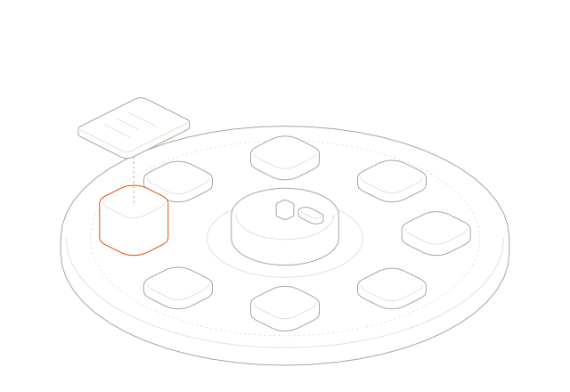</picture></p>

The wheel reads the extension of every file you hold, then keeps what works for all of them:

- **Convert** shows the targets the files have in common. Four PNGs offer eight targets; a PNG and a WAV offer none, and the wheel says so instead of failing later.
- **Tools** need one kind of file at a time, in the right number. One photo offers every image tool but the collage; several photos offer the batch ones (resize, rotate & flip, create a PDF) and *Create a collage*; two PDFs offer *Merge PDFs*. *Compress* and *Edit metadata* take any media.
- **Outputs never overwrite.** `photo.png` already there? You get `photo 2.png`. Batches reserve distinct names even when jobs overlap.

<picture><source media="(prefers-color-scheme: dark)" srcset="docs/readme/divider-dark.svg"></picture>

## Formats

<p align="center"><picture><source media="(prefers-color-scheme: dark)" srcset="docs/readme/formats-dark.svg"></picture></p>

**184 routes** between 28 formats. Apple frameworks do most of the work (ImageIO, PDFKit, AVFoundation). [FFmpeg](#ffmpeg-optional) is optional and fills the gaps: MP3, FLAC, OGG, Opus, WMA, MKV, WebM, AVI, WMV, GIF, and AVIF/WebP encoding where macOS cannot write them. WebP has a built-in lossless fallback when FFmpeg lacks `libwebp`.

<details open>
<summary><b>Images</b> · 67 routes</summary>

| From | To |
| --- | --- |
| **JPEG** `.jpg .jpeg .jpe .jfif` | PNG · WebP · HEIC · TIFF · AVIF · BMP · PDF · DOCX · TXT |
| **PNG** | JPEG · WebP · HEIC · TIFF · AVIF · BMP · PDF · DOCX · TXT |
| **WebP** · **HEIC** `.heif` · **TIFF** `.tif` · **AVIF** · **BMP** | any other of JPEG, PNG, WebP, HEIC, TIFF, AVIF, BMP · PDF · TXT |
| **SVG** | JPEG · PNG · WebP · HEIC · TIFF · AVIF · BMP · PDF · TXT |

**TXT** reads the text in the picture with Apple Vision, on this Mac.

</details>

<details>
<summary><b>Audio</b> · 56 routes</summary>

| From | To |
| --- | --- |
| **MP3** · **M4A** `.aac .m4b` · **WAV** · **FLAC** · **OGG** · **Opus** · **AIFF** `.aif` · **WMA** | any other of the eight |

</details>

<details>
<summary><b>Video</b> · 48 routes</summary>

| From | To |
| --- | --- |
| **MP4** `.m4v` · **MOV** `.qt` · **MKV** · **WebM** · **AVI** · **WMV** | any other of the six · GIF · MP3 (the soundtrack) |
| **GIF** | MP4 · MOV · MKV · WebM · AVI · WMV |

</details>

<details>
<summary><b>Documents & subtitles</b> · 13 routes</summary>

| From | To |
| --- | --- |
| **PDF** | DOCX · JPEG · PNG · TXT (scanned pages are read with Apple Vision) |
| **TXT** `.txt .md .log` | PDF · JPEG · PNG · SRT · VTT |
| **SRT** · **VTT** | each other · TXT |

DOCX is an output (from PDF and images), not an input. Word files are not converted in general.

</details>

<details>
<summary><b>Archives</b> · paused</summary>

ZIP, TAR, GZ and RAR are recognised but have no routes. Extraction stays off until it is bounded, protected against path traversal and links, and isolated. Zipping a selection is on the [roadmap](#roadmap).

</details>

The catalogue describes potential routes. Codec availability depends on your FFmpeg build; see [build status](docs/BUILD-STATUS.md) for what the regression matrix covers end to end.

<picture><source media="(prefers-color-scheme: dark)" srcset="docs/readme/divider-dark.svg"></picture>

## Tools

<p align="center"><picture><source media="(prefers-color-scheme: dark)" srcset="docs/readme/tools-dark.svg"></picture></p>

Hold <kbd>⌘</kbd> while dragging and pick a tool: a native window opens with a live preview. Originals are never modified; every tool writes a new copy.

<details open>
<summary><b>Images</b> · 12 tools</summary>

| Tool | Takes | What it does |
| --- | --- | --- |
| **Edit photo** | 1 image | Light, color and detail: exposure, brightness, contrast, highlights, shadows, saturation, vibrance, temperature, tint, monochrome, sepia. Hold to compare. |
| **Add a background** | 1 image | Places the image on a color, gradient or image background at a chosen aspect ratio. |
| **Remove background** | 1 or more | Keeps the people, animals and objects in front and makes the rest transparent: a PNG next to each original. Refine one image by hand with a **magic wand** (click a patch of similar color) or a **brush**, to remove more or bring parts back, with undo. Zoom in with <kbd>⌃</kbd> and the scroll wheel, a pinch or ⌘+ to work on the edges; moving *Tolerance* or *Brush size* redoes your last click or stroke with the new value. Edge softness, crop to subject, before/after. Apple Vision, on-device. |
| **Upscale image** | 1 or more | ×2 or ×4. *Enlarge* resamples smoothly; *Enhance details* rebuilds edges and texture with the Mac's machine-learning super resolution, tile by tile. A before/after of a detail at the new size. |
| **Hide faces** | 1 or more | Finds every face with Apple Vision and blurs, pixelates or boxes it, with an adjustable margin. |
| **Add a watermark** | 1 or more | Text or a logo, in a corner, the middle or repeated across the picture; size and opacity follow each image's size. |
| **Crop image** | 1 image | Free or fixed ratio, exact pixel size, saved at full resolution. |
| **Redact photo** | 1 image | Covers areas with a solid box, blur or pixelation. Move and resize each area. |
| **Resize images** | 1 or more | By long edge, percent or exact size, aspect kept. Never enlarges in long-edge mode. |
| **Rotate & flip** | 1 or more | Quarter turns and horizontal/vertical flips, same transform for all. |
| **Create a PDF** | 1 or more | One page per image, in list order. HEIC, WebP and SVG are rasterized as needed. |
| **Create a collage** | 2 or more | Grid, row, column or featured layout; square, landscape or portrait; spacing, corner radius, background. |

</details>

<details>
<summary><b>Video</b> · 9 tools</summary>

| Tool | Takes | What it does |
| --- | --- | --- |
| **Trim video** | 1 video | Start and end with frame stepping (<kbd>←</kbd> <kbd>→</kbd>). Copied without re-encoding when the format allows. |
| **Crop video** | 1 video | Draw the area; output is MP4 (H.264), audio kept as is. |
| **Change video speed** | 1 video | Faster or slower, with optional pitch preservation. |
| **Join videos** | 2 or more | One MP4; other clips are scaled and letterboxed to the first clip's size. |
| **Save video frames** | 1 video | Pick exact frames, or one every N seconds, at full resolution as PNG, JPEG or HEIC. |
| **Split video** | 1 video | At chosen points or into equal parts, numbered in one folder. Lossless when possible. |
| **Redact video** | 1 video | Cover areas, each with its own time range. |
| **Hide faces** | 1 video | Every frame is searched, so faces that move or appear later stay hidden. MP4 and MOV. |
| **Subtitles from speech** | 1 or more | Transcribes what is said into SRT, WebVTT or text, timed word by word, with Apple's on-device speech recognition. |

</details>

<details>
<summary><b>Audio</b> · 6 tools</summary>

| Tool | Takes | What it does |
| --- | --- | --- |
| **Normalize volume** | 1 file | EBU R128 loudness with Podcast, Music and Broadcast presets (FFmpeg), peak normalization without it. |
| **Audio visualizer** | 1 file | Renders an MP4 (H.264 + AAC): animated waveform, frequency bars or still image; landscape, portrait or square. Needs FFmpeg. |
| **Trim audio** | 1 file | Start and end at the playhead; removes leading and trailing silence in one click. |
| **Audio channels** | 1 file | Stereo, mono mix-down, left or right to both, or swap. Needs FFmpeg. |
| **Bleep audio** | 1 file | Adds bleeps at the playhead, nudged to the tenth of a second. |
| **Subtitles from speech** | 1 or more | A recording or a voice memo to SRT, WebVTT or text, on this Mac. |

</details>

<details>
<summary><b>PDF</b> · 5 tools</summary>

| Tool | Takes | What it does |
| --- | --- | --- |
| **Merge PDFs** | 2 or more | Combined in list order, starting from the Finder selection. Password-protected PDFs are skipped with an error. |
| **Organize PDF pages** | 1 PDF | Reorder, rotate, duplicate, remove or reverse pages. |
| **Split PDF** | 1 PDF | One file per page, every N pages, or custom ranges like `1-3, 5`. |
| **Add a password** | 1 or more | A copy that asks for a password to open, with an optional owner password. |
| **Remove the password** | 1 or more | A copy that opens freely, for PDFs whose password you know. |

</details>

<details>
<summary><b>Any file</b> · 3 tools, and 10 file actions</summary>

| Tool | Takes | What it does |
| --- | --- | --- |
| **Compress** | images, video, audio, PDF | *Balanced* or *Strong*, image long edge (2560, 1920, 1280 px), or a **target file size** per file. Videos: **H.264 or HEVC**, resolution (4K to 480p) and frame rate (60, 30, 24). Transparent PNGs stay PNG. |
| **Edit metadata** | any media | Edit fields, remove all metadata, or only camera, GPS and processing data. Writes a copy. |
| **Translate** | subtitles, text, PDFs, pictures | Apple's on-device translation. Subtitles keep every timing and are saved as `name.fr.srt`, which players pick up; pictures and PDFs give their recognised text. |

| File action (<kbd>⌃</kbd>) | What it does |
| --- | --- |
| **Reveal** | Shows the files in Finder. |
| **Copy Files** | Puts the files on the clipboard. |
| **Copy Paths** | Copies their paths, one per line. |
| **Duplicate** | Makes `name copy.ext` next to each file or folder. |
| **ZIP** | One item becomes `name.zip`, several become `Archive.zip`, folders included, never overwriting. |
| **Rename** | Renames files and folders in place from a pattern (`{name}`, `{n}`, `{date}`), with find and replace, case and a live preview. Clashes are caught first, and if one rename fails every file keeps its name. |
| **Unzip** | Unpacks a ZIP next to it, after checking every entry: no paths outside the folder, no links, at most 20 GB and nothing that inflates a thousand times. |
| **Copy Text** | Reads the text in images and PDFs (scanned pages too) with Apple Vision and puts it on the clipboard. |
| **Read Codes** | Finds QR codes and barcodes in images and PDFs. Hover one on the picture to see what it holds; click a link to open it, or copy it. |
| **SHA-256** | Streams each file and copies `checksum  name` lines to the clipboard. |

</details>

<picture><source media="(prefers-color-scheme: dark)" srcset="docs/readme/divider-dark.svg"></picture>

## Progress in the notch

<p align="center"><picture><source media="(prefers-color-scheme: dark)" srcset="docs/readme/notch-dark.svg"></picture></p>

Work shows where your eyes already are. The panel grows out of the physical notch and folds back into it when done; on a display without a notch it sits at the top and follows light or dark. While the wheel is open it says what the choice under the pointer does (“Rotate & flip: turns pictures a quarter at a time, or mirrors them”), and it leaves when the wheel closes:

- an original **citrus companion** that watches the wheel, gets busy, delivers and smiles, or frowns when a file fails;
- one row per file with its own progress, up to three visible, the rest scroll; **cancel** at any time;
- **Open** and **Show in Finder** on each result, which stays eight seconds, longer while hovered;
- a **Pure black** (default) or **Glass** surface; Reduce Motion and Reduce Transparency are respected.

Prefer a floating card in the top-right corner? *Settings → Appearance → Progress → Card*.

<picture><source media="(prefers-color-scheme: dark)" srcset="docs/readme/divider-dark.svg"></picture>

## Settings

| Section | Setting | Default |
| --- | --- | --- |
| **General** | Save converted files: next to the original, Downloads or Desktop | next to the original |
| | Reveal results in Finder | on |
| | Start automatically at login (move the app to Applications first) | off |
| | Watch folders: new files that arrive are converted to the format you pick | none |
| | Open the wheel with Shift alone, for Finder's selection | on |
| **Appearance** | Theme: System, Light or Dark | System |
| | Progress: Card or Notch pill · Notch surface: Pure black or Glass | Notch pill · Pure black |
| **Formats** | JPEG / HEIC / WebP quality (30–100 %) | 90 % |
| | Compression preset: Balanced or Strong · resize long edge (0 = keep) | Balanced · 0 |
| | FFmpeg path, auto-detected from Homebrew, MacPorts or `/usr/local/bin` | auto |

The drag modifiers, and scrolling to switch wheels, are listed under *General* for reference. Settings are stored in the app's standard user defaults.

<picture><source media="(prefers-color-scheme: dark)" srcset="docs/readme/divider-dark.svg"></picture>

## Screenshots

Real windows from the current build, light and dark follow your GitHub theme. They are rendered offscreen by [`scripts/readme/Screenshots.swift`](scripts/readme/Screenshots.swift), so they never drift from the code.

<p align="center"><picture><source media="(prefers-color-scheme: dark)" srcset="docs/readme/screens/tool-removeBackground-dark.webp">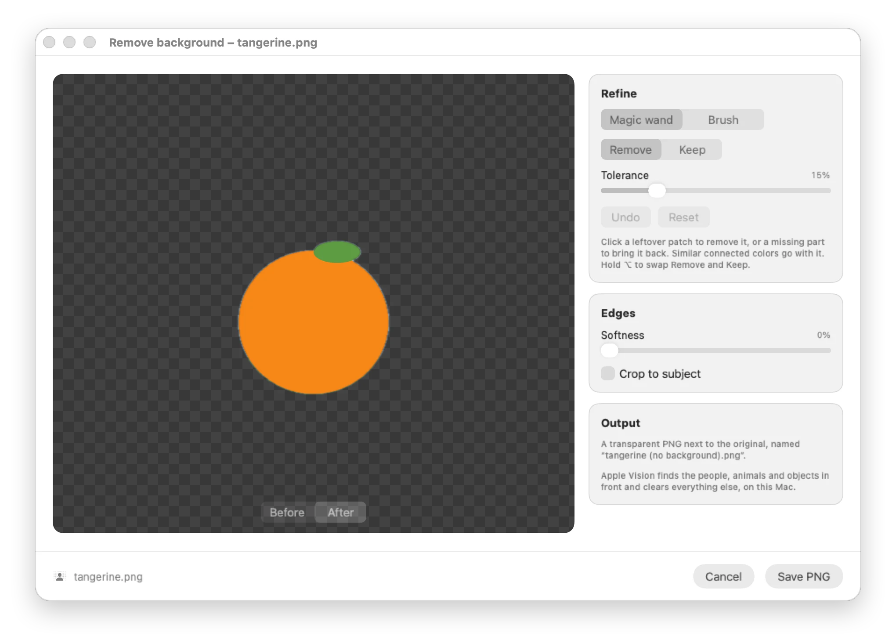</picture><br><sub><b>Remove background</b> · the subject on a checkerboard, refined with the magic wand or the brush</sub></p>

<table>
<tr>
<td width="50%"><picture><source media="(prefers-color-scheme: dark)" srcset="docs/readme/screens/tool-cropImage-dark.webp">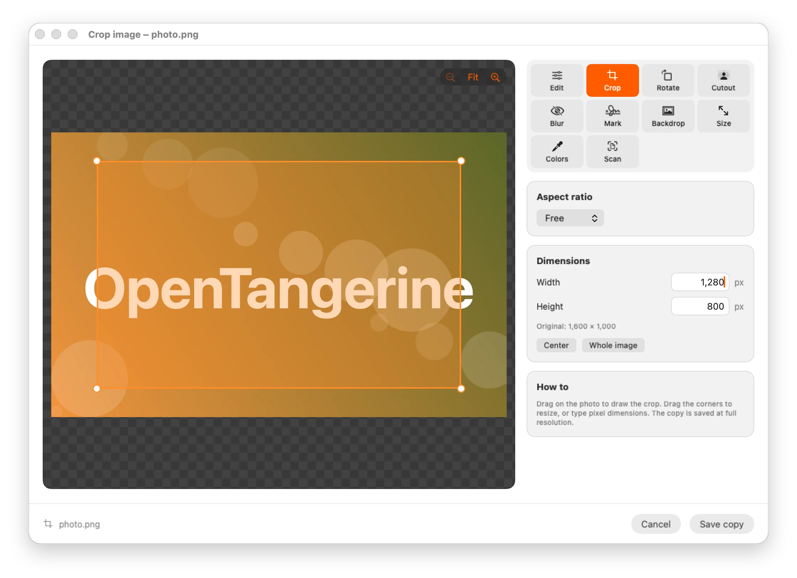</picture></td>
<td width="50%"><picture><source media="(prefers-color-scheme: dark)" srcset="docs/readme/screens/tool-editImage-dark.webp">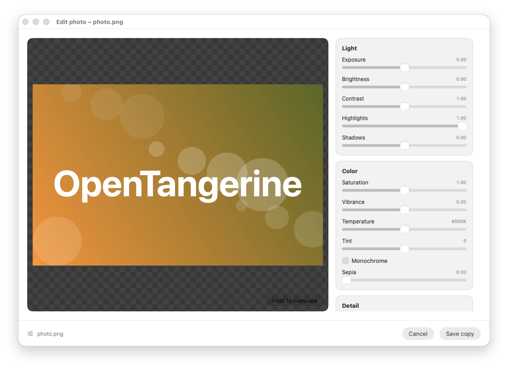</picture></td>
</tr>
<tr>
<td align="center"><b>Crop image</b><br><sub>free or fixed ratio, exact pixels, full resolution</sub></td>
<td align="center"><b>Edit photo</b><br><sub>light, color and detail, hold to compare</sub></td>
</tr>
<tr>
<td width="50%"><picture><source media="(prefers-color-scheme: dark)" srcset="docs/readme/screens/tool-upscaleImage-dark.webp">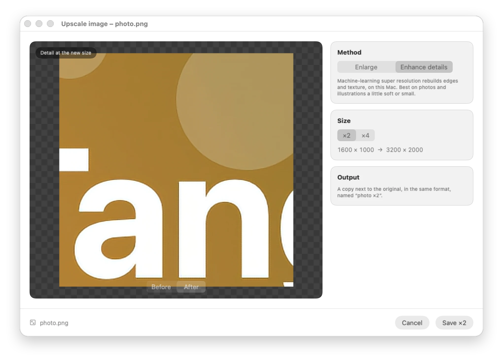</picture></td>
<td width="50%"><picture><source media="(prefers-color-scheme: dark)" srcset="docs/readme/screens/tool-watermarkImage-dark.webp">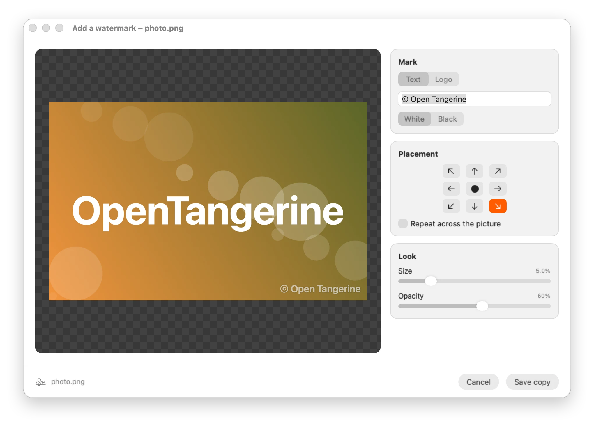</picture></td>
</tr>
<tr>
<td align="center"><b>Upscale image</b><br><sub>smooth enlargement or super resolution, ×2 or ×4</sub></td>
<td align="center"><b>Add a watermark</b><br><sub>text or logo, in a corner or repeated</sub></td>
</tr>
<tr>
<td width="50%"><picture><source media="(prefers-color-scheme: dark)" srcset="docs/readme/screens/tool-createCollage-dark.webp">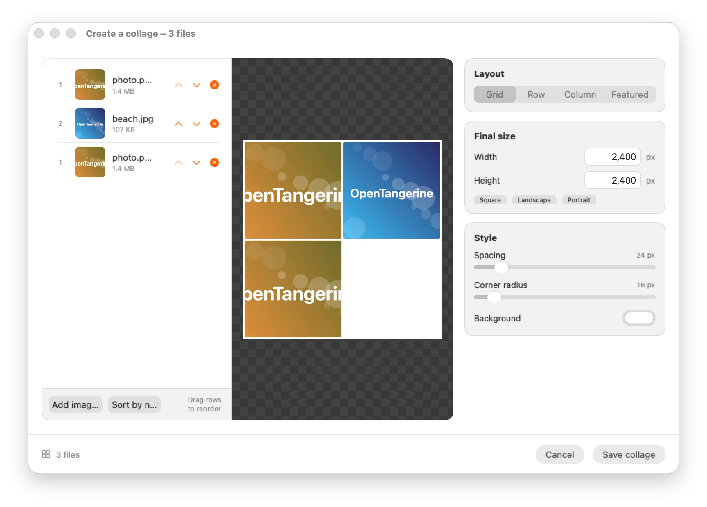</picture></td>
<td width="50%"><picture><source media="(prefers-color-scheme: dark)" srcset="docs/readme/screens/tool-compress-dark.webp">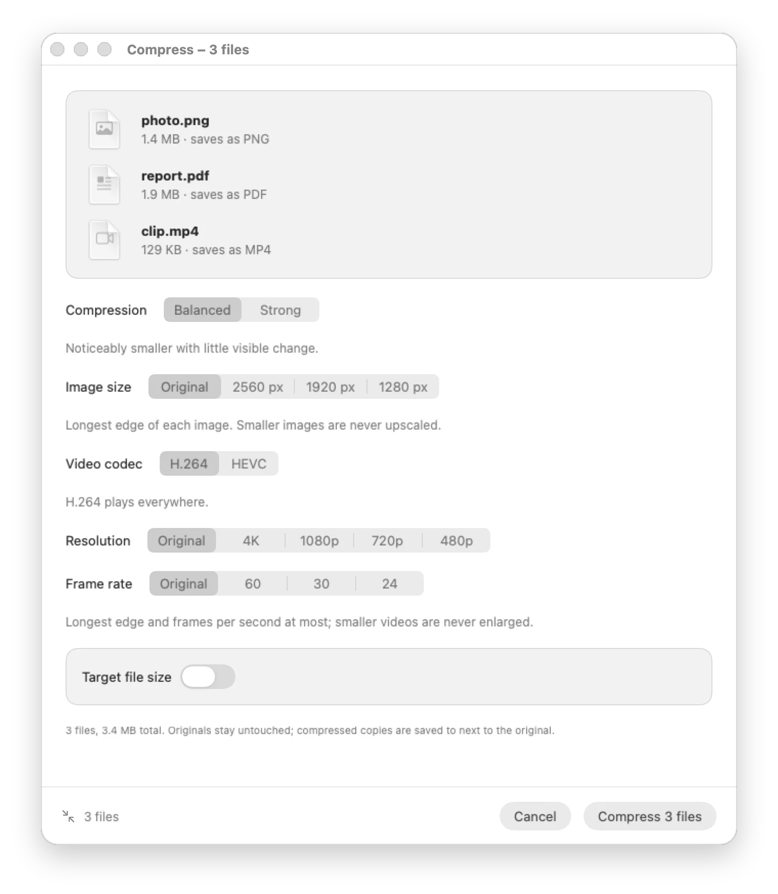</picture></td>
</tr>
<tr>
<td align="center"><b>Create a collage</b><br><sub>grid, row, column or featured</sub></td>
<td align="center"><b>Compress</b><br><sub>images, video, audio and PDF in one batch</sub></td>
</tr>
<tr>
<td width="50%"><picture><source media="(prefers-color-scheme: dark)" srcset="docs/readme/screens/tool-normalizeAudio-dark.webp">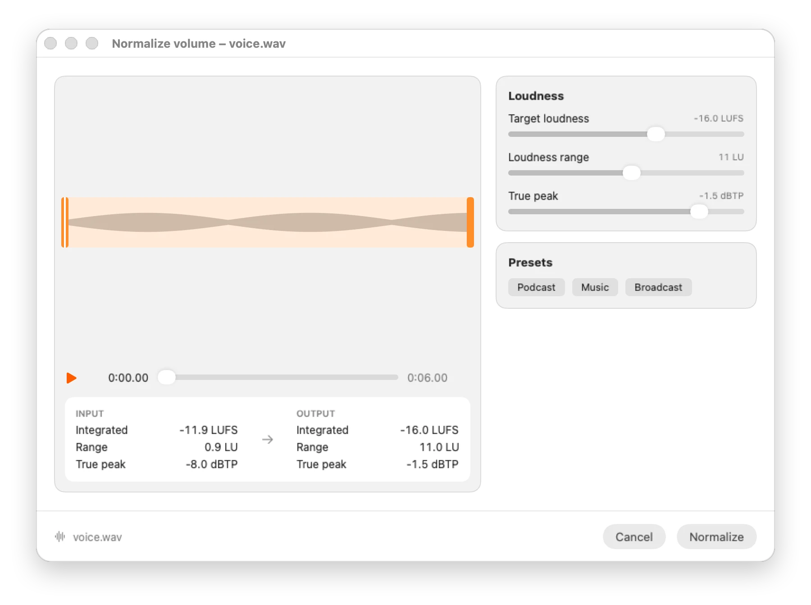</picture></td>
<td width="50%"><picture><source media="(prefers-color-scheme: dark)" srcset="docs/readme/screens/tool-organizePDF-dark.webp">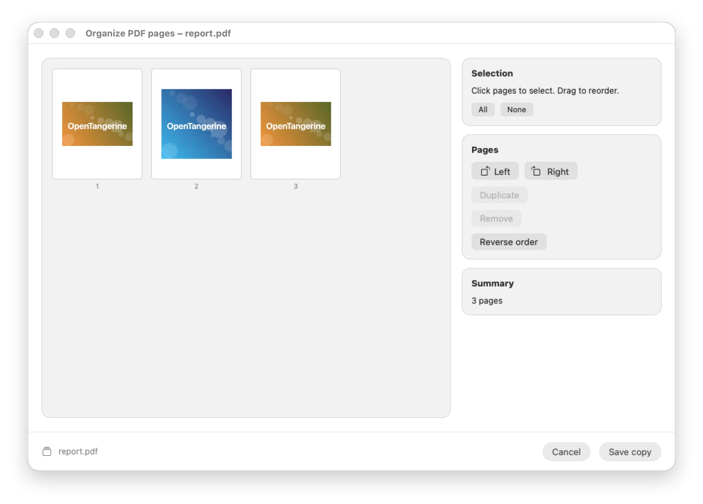</picture></td>
</tr>
<tr>
<td align="center"><b>Normalize volume</b><br><sub>EBU R128 loudness, measured before and after</sub></td>
<td align="center"><b>Organize PDF pages</b><br><sub>reorder, rotate, duplicate, remove</sub></td>
</tr>
<tr>
<td width="50%"><picture><source media="(prefers-color-scheme: dark)" srcset="docs/readme/screens/settings-general-dark.webp">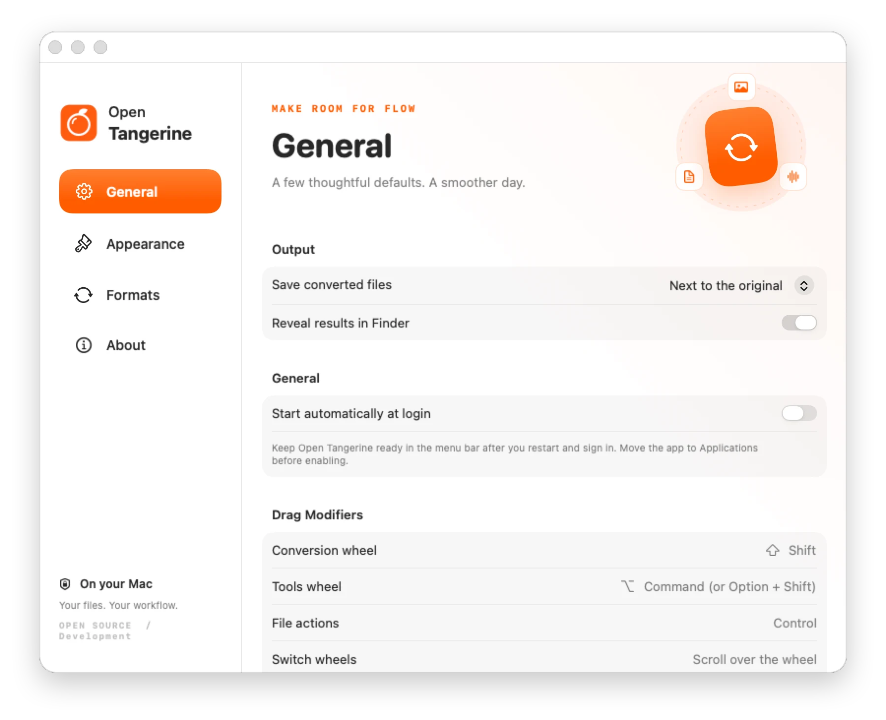</picture></td>
<td width="50%"><picture><source media="(prefers-color-scheme: dark)" srcset="docs/readme/screens/settings-conversion-dark.webp">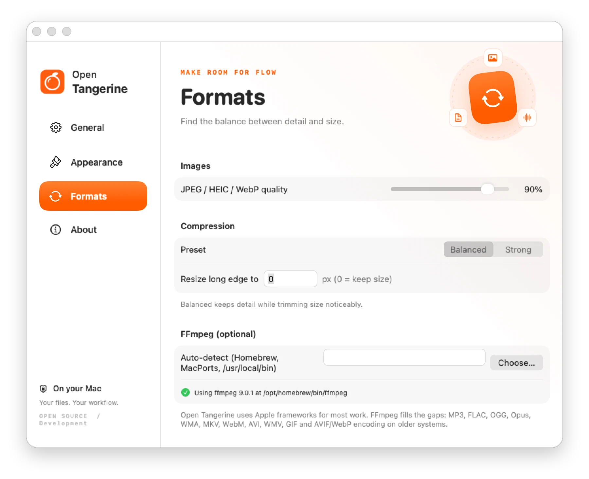</picture></td>
</tr>
<tr>
<td align="center"><b>Settings · General</b><br><sub>where results go, login, drag modifiers</sub></td>
<td align="center"><b>Settings · Formats</b><br><sub>quality, compression, FFmpeg</sub></td>
</tr>
</table>

<picture><source media="(prefers-color-scheme: dark)" srcset="docs/readme/divider-dark.svg"></picture>

## Roadmap

<p align="center"><picture><source media="(prefers-color-scheme: dark)" srcset="docs/readme/roadmap-dark.svg"></picture></p>

What this fork adds on top of upstream, shipped in 0.2.0, and what could come next. Everything stays on-device, built on Apple frameworks, with no service, account or API key.

<table>
<tr>
<td width="50%"><picture><source media="(prefers-color-scheme: dark)" srcset="docs/readme/hairline-cutout-dark.svg"></picture></td>
<td width="50%"><picture><source media="(prefers-color-scheme: dark)" srcset="docs/readme/hairline-press-dark.svg">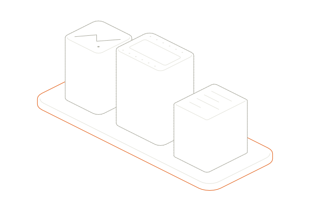</picture></td>
</tr>
<tr>
<td align="center"><b>Remove background</b><br><sub>drop a photo, get the subject as a transparent PNG</sub></td>
<td align="center"><b>Compression 2.0</b><br><sub>video, images and PDF, sized the way you ask</sub></td>
</tr>
</table>

| Feature | What it does | Status |
| --- | --- | --- |
| **Remove background** | Any photo → its subject on a transparent PNG, from the <kbd>⌘</kbd> wheel, one image or a batch, refined with a magic wand or a brush, with edge softness and crop to subject. Apple Vision foreground masks, on-device. | 🟢&nbsp;shipped |
| **Compression 2.0** | Videos in H.264 or HEVC, capped resolution (4K to 480p) and frame rate (60, 30, 24), next to the presets, image sizes and target file sizes. | 🟢&nbsp;shipped |
| **ZIP in one drop** | A <kbd>⌃</kbd> action that zips files and folders: `name.zip` or `Archive.zip`, never overwriting. | 🟢&nbsp;shipped |
| **Text from images** | Images and scanned PDFs to `.txt`, or *Copy Text* to the clipboard, with Apple Vision. | 🟢&nbsp;shipped |
| **Watch folders** | Pick folders and a format in Settings; files that arrive are converted. | 🟢&nbsp;shipped |
| **Batch rename & watermark** | Rename from a pattern with a preview and rollback; text or logo watermarks. | 🟢&nbsp;shipped |
| **Upscale images** | ×2 and ×4: smooth enlargement, or machine-learning super resolution. | 🟢&nbsp;shipped |
| **Hide faces** | Blur, pixelate or box every face in photos and videos. | 🟢&nbsp;shipped |
| **Translate** | Subtitles, text, PDFs and pictures, with Apple's on-device translation. | 🟢&nbsp;shipped |
| **Unzip safely** | Extract ZIPs after checking paths, links, size and inflation. | 🟢&nbsp;shipped |
| **Subtitles from speech** | Videos and recordings to SRT, WebVTT or text, on-device. | 🟢&nbsp;shipped |
| **PDF passwords** | Add one, or remove one you know. | 🟢&nbsp;shipped |
| **Finder Quick Actions** | Right-click → Services → Open Tangerine. | 🟢&nbsp;shipped |
| **Read QR codes** | Links and text from QR codes and barcodes, hover to see, click to open. | 🟢&nbsp;shipped |
| **Scan documents** | A photo of a page, straightened and cropped into a clean PDF. | 🟠&nbsp;proposed |
| **Searchable PDFs** | Add a hidden text layer to scanned PDFs so they can be searched and copied. | 🟠&nbsp;proposed |
| **Smooth slow motion** | New frames between frames for slow, fluid video. | 🟠&nbsp;proposed |
| **Upscale & denoise video** | VideoToolbox super resolution and noise filtering for clips. | ⚪&nbsp;idea |
| **Colour palette** | The main colours of a picture, ready to copy. | ⚪&nbsp;idea |
| **Undo history** | Take back any conversion or rename. | ⚪&nbsp;idea |

Ideas and requests are welcome in [issues](https://github.com/M-U-C-K-A/Open-Tangerine/issues). Upstream's longer-term direction lives in [docs/PRD.md](docs/PRD.md); roadmap items are not current capabilities.

<picture><source media="(prefers-color-scheme: dark)" srcset="docs/readme/divider-dark.svg"></picture>

## Install

Requires **macOS 26 or later**.

### From a release

1. Download the ZIP from the [latest release of this fork](https://github.com/M-U-C-K-A/Open-Tangerine/releases). Until this fork publishes one, [build from source](#build-from-source): upstream releases do not include this fork's features.
2. Quit the previous version if it is running, unzip, and drag **Open Tangerine** into **Applications** (choose *Replace* when updating).
3. Open it. The build is ad-hoc signed and **not notarized**, so macOS may block it the first time: allow it for this app only in *System Settings → Privacy & Security*. Never disable Gatekeeper globally.

> [!IMPORTANT]
> *Check for Updates on GitHub* compares your version with this fork's latest published release and opens its releases page. There is no automatic installation yet: that needs a notarized, signed update channel.

### Build from source

Needs Xcode 26 (or matching Command Line Tools) and Git. No package manager, no third-party Swift dependency: the script calls Apple's Swift compiler directly.

```bash
git clone https://github.com/M-U-C-K-A/Open-Tangerine.git
cd Open-Tangerine
./scripts/build-app.sh
open "dist/Open Tangerine.app"
```

Drag `dist/Open Tangerine.app` to Applications to keep it, then enable *Settings → General → Start automatically at login* if you want it there after a restart.

### FFmpeg (optional)

```bash
brew install ffmpeg
```

Open Tangerine finds FFmpeg in Homebrew, MacPorts or `/usr/local/bin`, or at a path you choose in *Settings → Formats*, which also shows whether it was found. It is never bundled or downloaded silently.

<picture><source media="(prefers-color-scheme: dark)" srcset="docs/readme/divider-dark.svg"></picture>

## Privacy

<p align="center"><picture><source media="(prefers-color-scheme: dark)" srcset="docs/readme/hairline-local-dark.svg">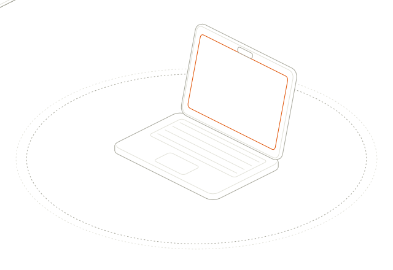</picture></p>

- **Files never leave your Mac.** Every conversion and tool runs locally with Apple frameworks, or with your own FFmpeg.
- **Finder's selection is read only when you ask:** with *Shift alone* on, holding Shift asks Finder which files are selected, through Apple Events you allow once. You can turn it off in *Settings → General*.
- **Network, rarely:** the update check reads the latest public GitHub release, at most once a day, sending no file names, content or account. The first time you translate to a language or transcribe one, macOS downloads Apple's model for it; your files are never sent.
- **No account, no analytics in the app, no AI service**, so no API key and no usage charge. Any future AI feature must be opt-in and bring-your-own-key.
- Metadata removal and visible redaction are helpful, not certified: review exported files before sharing sensitive documents.

See [SECURITY.md](SECURITY.md) to report a vulnerability.

<picture><source media="(prefers-color-scheme: dark)" srcset="docs/readme/divider-dark.svg"></picture>

## Limitations

- **Not full Tangerine parity yet:** no universal Office conversion, undo history or plugin installer. Some are on the [roadmap](#roadmap).
- ZIP archives can be created and unpacked; TAR, GZ and RAR are not handled yet.
- Watch folders only see files added while the app runs; files already in a folder are left alone.
- *Add a background* adds a background; it does not remove the existing one. Run *Remove background* first for that.
- *Remove background* keeps every foreground subject Apple Vision finds, as one cut-out. It needs a subject that stands out from the background. Refining by hand (wand and brush) works on one image at a time, not on a batch.
- Archive conversion is disabled until bounded extraction, traversal and link defenses, and isolation are in place.
- Native image loading is limited to 100 MB and 40 megapixels. Animated and multipage images need more work; use single-frame images.
- Heavy native operations can briefly block the interface. Cancelling external processes is best-effort; worker isolation and timeouts are release gates.
- No App Sandbox, notarization, automatic updates, Intel-specific verification or complete accessibility audit yet.

<picture><source media="(prefers-color-scheme: dark)" srcset="docs/readme/divider-dark.svg"></picture>

## Development

```bash
./scripts/test.sh               # compile once, run the 8 regression suites in separate processes
./scripts/build-app.sh          # build and ad-hoc sign dist/Open Tangerine.app
./scripts/readme/build.sh       # regenerate the README art (add --screens for the screenshots)
node scripts/test-site.cjs      # website checks (also test-demo.cjs, test-analytics.cjs)
```

**How it works.** `DragMonitor` notices a Finder drag with a modifier held and hands the file URLs to `RadialController`. The wheel's items come from `ConversionMatrix.targets(for:)` (common targets of every file), `ToolID.available(for:)` (tools whose category and arity fit) or `FileAction`. Picking one queues a job per file on `JobRunner`, which picks an engine (ImageIO, AVFoundation, PDFKit, FFmpeg), reserves a unique output name next to the source, and reports progress to the notch or card HUD. Tools open a SwiftUI window over a `ToolSession` and write copies the same way.

```text
NativeApp/Sources/
├─ App.swift            entry point: a menu-bar app with a Settings scene
├─ App/                 menu and delegate, settings, update checker, screenshot driver
├─ Radial/              drag monitor, wheel controller, wheel view (Liquid Glass)
├─ Formats/             FileFormat (detection, aliases, UTTypes), ConversionMatrix (routes, output names)
├─ Engines/             image, video, audio, document, subtitle, archive, FFmpeg, AVExporter, WebP lossless, DOCX writer
├─ Operations/          image, video, audio, PDF and metadata operations, Compressor
├─ Tools/               ToolID catalogue, tool windows by family, file actions
├─ Core/                JobRunner (batches, progress, notch and card), Shell, MediaInfo, errors, log
└─ UI/                  theme, brand artwork, the citrus companion
NativeApp/Tests/        8 suites: Satsuma, Integration, Interaction, ImageConversion, Document, Batch, ImageTools, MediaIntegration
scripts/                build, test and packaging entry points; readme/ for this page's art
docs/                   the website (GitHub Pages), design and build notes, readme/ assets
```

**Tests** run real conversions: each format route, batch naming, documents, image tools and media through FFmpeg where installed. [Build status](docs/BUILD-STATUS.md) lists what is covered and the known gaps. CI (`.github/workflows/build.yml`) runs the website checks, the suites and a packaged build on macOS 26.

**README art.** Every illustration here is generated, light and dark, on a transparent background:

| Script | Makes |
| --- | --- |
| [`scripts/readme/build.mjs`](scripts/readme/build.mjs) | the animated isometric SVGs: hero, workflow, gestures, formats, tools, notch, roadmap, divider |
| [`scripts/readme/hairline.mjs`](scripts/readme/hairline.mjs) | the hairline figures (one 1px stroke, one bright edge), in the style of [@lucasmarkes/hairline](https://lucasmarkes.com/lab/hairline) |
| [`scripts/readme/Screenshots.swift`](scripts/readme/Screenshots.swift) | the screenshots, rendered offscreen from the real app windows, then framed and saved as WebP |

Run `python3 -m http.server` at the repository root and open `/scripts/readme/preview.html` to see them all side by side. Node is only needed for this art, never for the app.

Contributions are welcome: see [CONTRIBUTING.md](CONTRIBUTING.md). Notes: [design](docs/DESIGN.md), [updates](docs/UPDATES.md), [analytics](ANALYTICS.md), [DragShift comparison](DRAGSHIFT_COMPARISON.md), [third-party notices](THIRD_PARTY_NOTICES.md).

<details>
<summary><b>Changelog</b> · 0.1.1 → 0.2.0</summary>

- **0.2.0** (this fork) — **Remove background** turns photos into transparent PNGs with Apple Vision, on-device, refined with a magic wand or a brush. **Scroll over the wheel** to move between Convert, Tools and File actions; dropping anywhere but on a choice keeps the wheel open. **Shift alone** opens the wheel for Finder's selection, no drag needed. **Upscale** (smooth or super resolution), **Hide faces** in photos and videos, **Translate**, **Subtitles from speech**, **PDF passwords**, **Unzip** and **Read Codes**, Finder **Quick Actions**, a notch that explains each choice and follows light or dark, and <kbd>⌃</kbd>-scroll zoom with retunable wand and brush in Remove background. **Compression 2.0** (H.264 or HEVC, resolution, frame rate), **ZIP**, **Rename** and **Copy Text** file actions (folders accepted), **text from images** and scanned PDFs, **watermarks** and **watch folders**. Check for Updates follows this fork's releases.
- **0.1.8** — *Pure black* (default) or *Glass* notch surface, with a black fallback under Reduce Transparency. The wheel springs in and lifts the highlighted segment. Results get **Open** and **Show in Finder**, stay eight seconds and remain while hovered. Settings show the installed version. Website analytics moved to a dedicated GoatCounter project.
- **0.1.7** — The notch panel has a solid sRGB black backing, expands from the physical notch and retracts into it. Reopening interrupts dismissal safely.
- **0.1.6** — Built-in lossless WebP fallback; AVIF and Ogg pick available encoders; batches reserve distinct names and report unsupported inputs per file; fixes for PDF/DOCX page order, precise trims, silent video, audio channels and bleeps, PNG compression, rotation, framing and metadata.
- **0.1.4** — GitHub Pages website and manual download updates.
- **0.1.2** — Notch progress by default, the citrus companion, clearer job status, batch scrolling, Check for Updates.
- **0.1.1** — Roomier settings with a sidebar, orange highlights, animated artwork, softer transitions, Reduce Motion support.

</details>

<picture><source media="(prefers-color-scheme: dark)" srcset="docs/readme/divider-dark.svg"></picture>

## Credits

- [**Open Tangerine**](https://github.com/sintaxerrorpvtltd/Open-Tangerine) by Syntax Error Private Limited — the app this fork builds on, its design and its citrus companion.
- [**Satsuma**](https://github.com/plyght/satsuma) by plyght — the original native converter, MIT licensed.
- [**@lucasmarkes/hairline**](https://lucasmarkes.com/lab/hairline) — the visual language of the line figures.
- Inspired by Tangerine. This project is independent and not affiliated with it.

## License

Open Tangerine additions © 2026 Syntax Error Private Limited and contributors, licensed under **GPL-3.0-only**: see [LICENSE](LICENSE). Commercial use and sale are permitted under that license; distributing covered derivatives requires the corresponding source and the GPL terms. Upstream Satsuma code © 2026 plyght remains under its original MIT terms, reproduced in [NativeApp/LICENSE](NativeApp/LICENSE). Contributors keep the copyright in their contributions. The license grants no rights to company names or logos.
