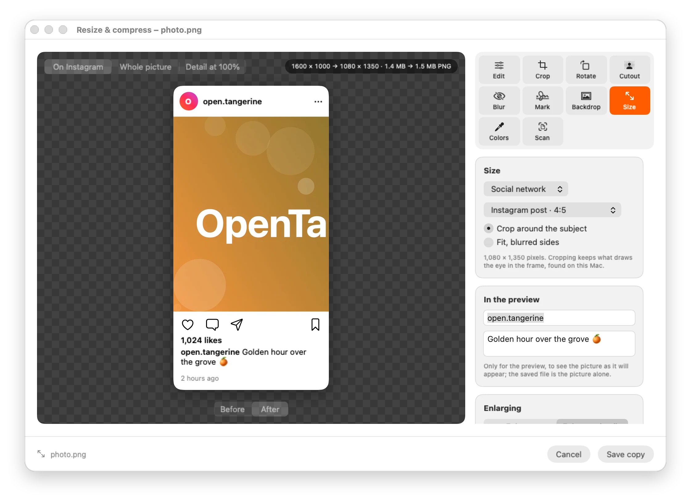
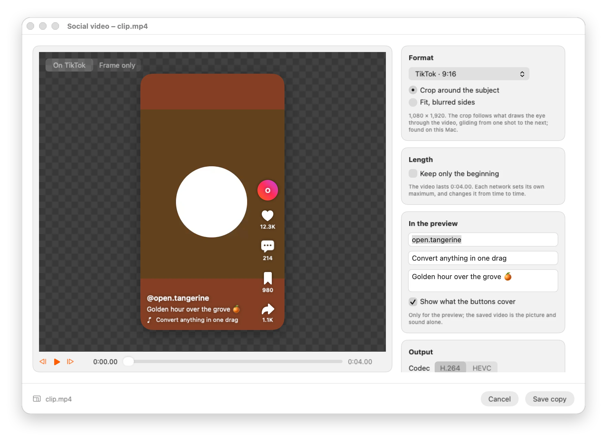
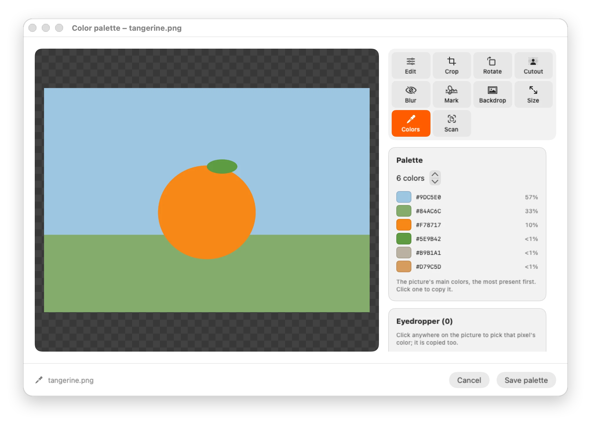
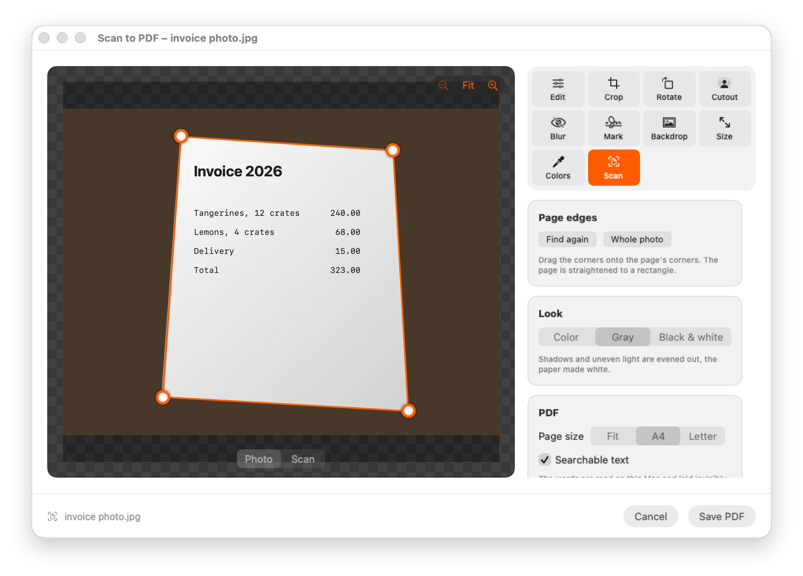
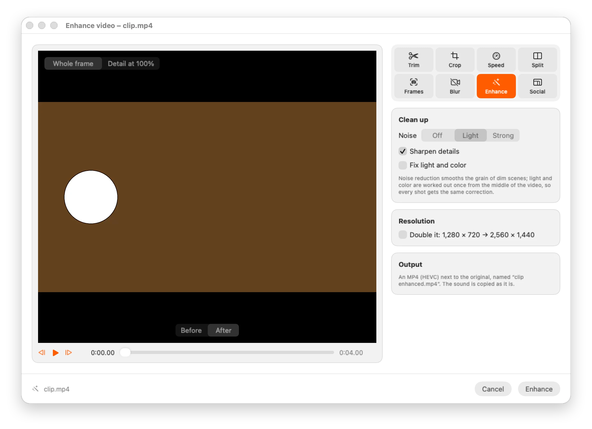
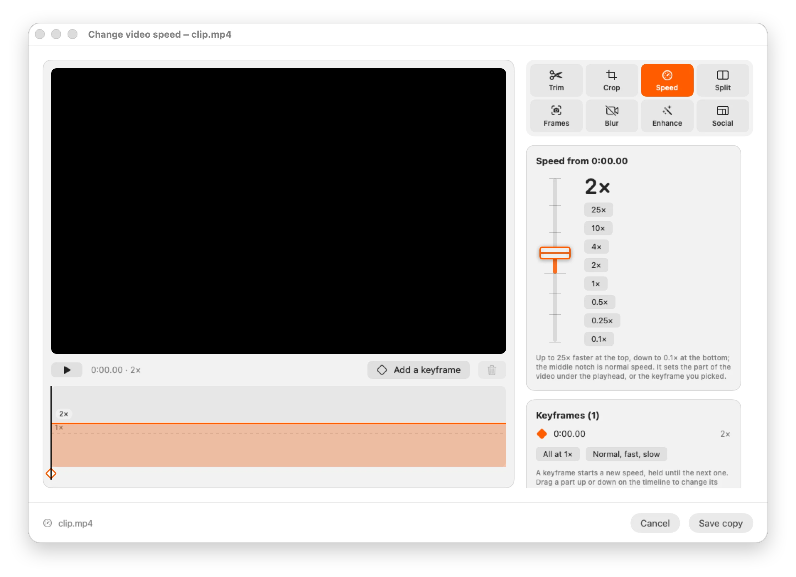
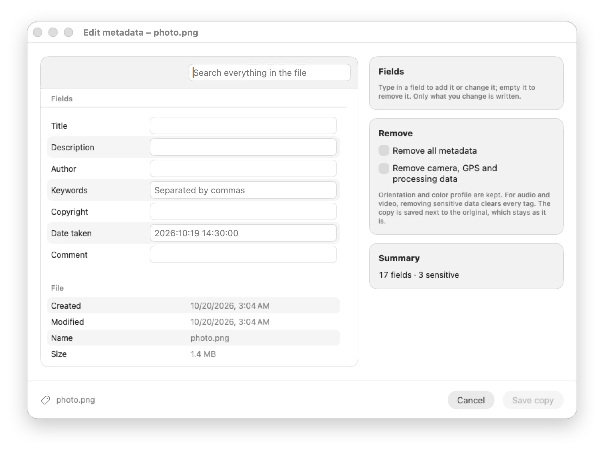
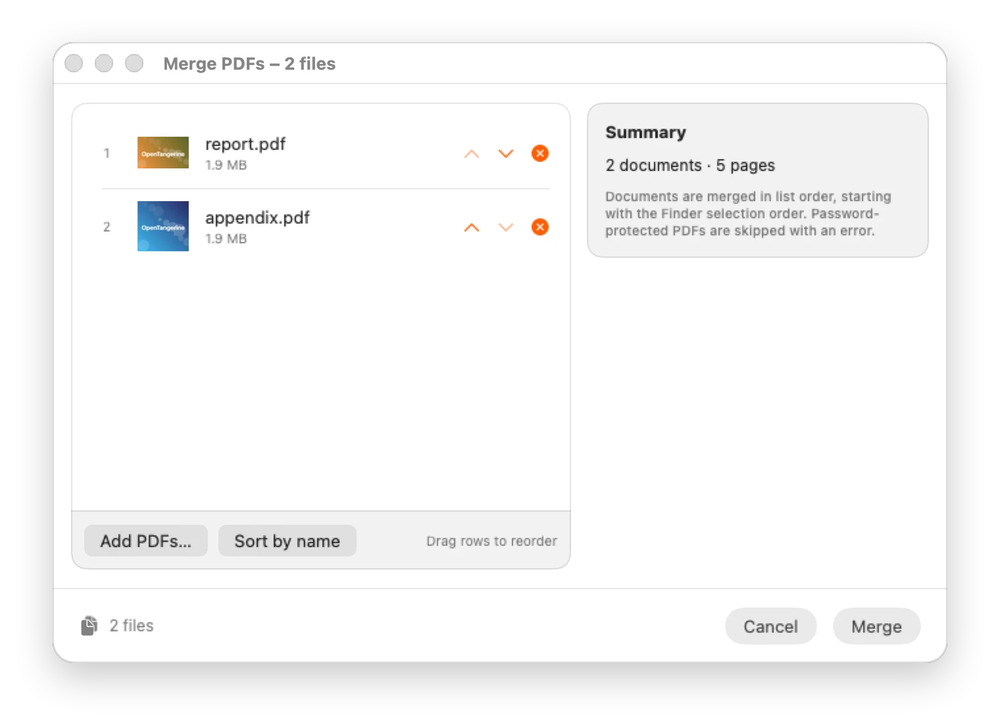
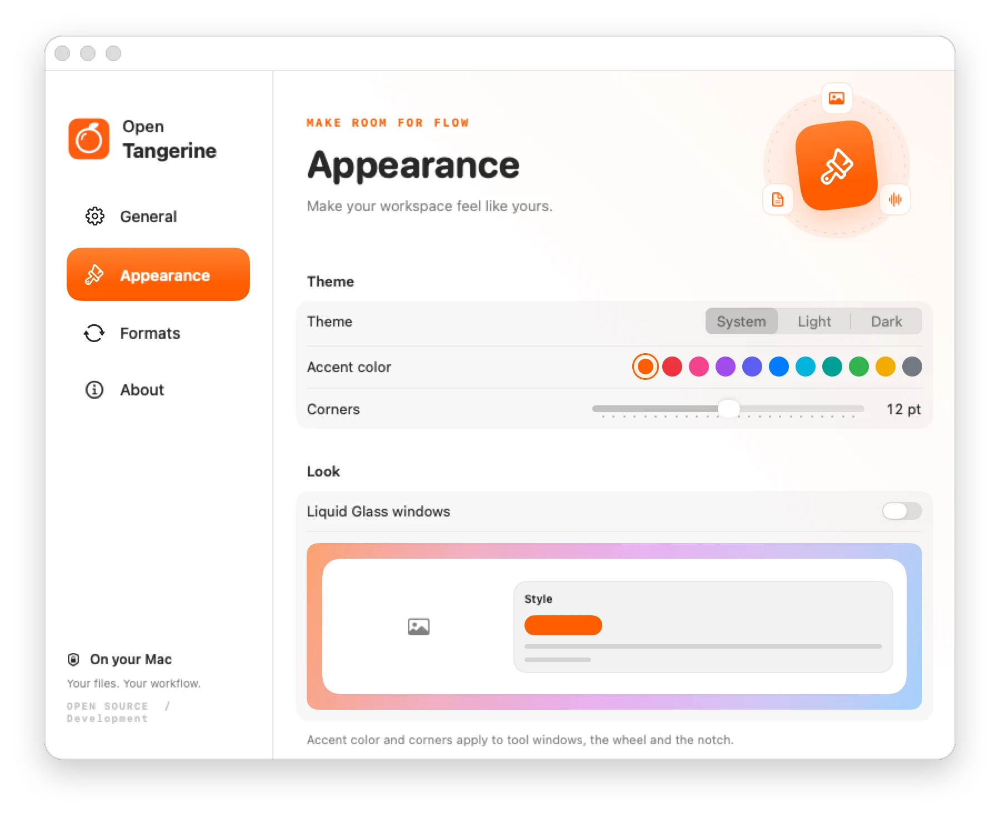

<p align="center">
  <picture><source media="(prefers-color-scheme: dark)" srcset="docs/readme/hero-dark.svg"></picture>
</p>

<p align="center">
  <b>A native macOS file converter and toolbox that lives in your menu bar.</b><br>
  Drag files in Finder, hold a key, drop them on a format or a tool. The result lands next to the original.<br>
  196 conversion routes, 37 tools, batch jobs and watch folders — all processed on your Mac. No account, no limits, no subscription.
</p>

<p align="center">
  <a href="https://github.com/M-U-C-K-A/Open-Tangerine/releases"></a>
  
  
  
  
  <a href="LICENSE"></a>
  <a href="https://github.com/M-U-C-K-A/Open-Tangerine/stargazers"></a>
</p>

<p align="center">
  <a href="#install"></a>
  <a href="#build-from-source"></a>
</p>

<p align="center">
  <a href="#quick-start">Quick start</a> ·
  <a href="#three-keys-three-wheels">Gestures</a> ·
  <a href="#formats">Formats</a> ·
  <a href="#tools">Tools</a> ·
  <a href="#progress-in-the-notch">Progress</a> ·
  <a href="#settings">Settings</a> ·
  <a href="#screenshots">Screenshots</a> ·
  <a href="#roadmap">Roadmap</a> ·
  <a href="#install">Install</a> ·
  <a href="#privacy">Privacy</a> ·
  <a href="#development">Development</a>
</p>

> [!NOTE]
> This repository is a fork of [**Open Tangerine**](https://github.com/sintaxerrorpvtltd/Open-Tangerine) by Sintax Error Private Limited, itself built on [Satsuma](https://github.com/plyght/satsuma) by plyght. Version **0.3.0** builds on upstream 0.1.9 and adds **background removal**, **scrolling between wheels**, **Shift alone** to open the wheel, document scanning, video enhancement, a color palette, social formats, Markdown ↔ HTML and more on the [roadmap](#roadmap). Check for Updates follows this fork's releases, never upstream's. It is an independent project, **not affiliated with Tangerine**, and still a developer trial (ad-hoc signed, not Apple-notarized).

<picture><source media="(prefers-color-scheme: dark)" srcset="docs/readme/divider-dark.svg"></picture>

## Quick start

<p align="center"><picture><source media="(prefers-color-scheme: dark)" srcset="docs/readme/workflow-dark.svg"></picture></p>

1. [Install](#install) the app and open it. It lives in the **menu bar**; Settings opens on first launch.
2. In Finder, select one file or a whole batch (say, four HEIC photos) and start dragging.
3. While dragging, hold <kbd>⇧ Shift</kbd>. The conversion wheel opens around the pointer. Move onto **PNG** and let go.
4. Each file is converted next to its original (`photo.heic` → `photo.png`). Progress grows out of the notch; a file that fails never stops the others.

> [!TIP]
> Not a dragger? Right-click files in Finder → **Services** (or **Quick Actions**) → *Convert with Open Tangerine*, *Open Tangerine Tools* or *Open Tangerine File Actions*. The menu-bar icon also has **Convert Files…**, **Open Tool for Files…** and **File Actions…**: they open a file picker, then the same wheel. **Pick a Color on Screen…** (<kbd>⌘</kbd><kbd>P</kbd>) copies the HEX code of any pixel on screen. Arrow keys move around the wheel, <kbd>Return</kbd> picks, <kbd>Esc</kbd> cancels.

Start with copies of ordinary files: PNG → JPEG, crop or resize a photo, turn two images into a PDF, merge two PDFs, copy a SHA-256 checksum.

<picture><source media="(prefers-color-scheme: dark)" srcset="docs/readme/divider-dark.svg"></picture>

## Three keys, three wheels

<p align="center"><picture><source media="(prefers-color-scheme: dark)" srcset="docs/readme/gestures-dark.svg"></picture></p>

Everything starts from a drag in Finder. The key you hold decides which wheel opens:

| Hold while dragging | Wheel | What it offers |
| --- | --- | --- |
| <kbd>⇧ Shift</kbd> | **Convert** | Every format the files you hold can become, and only those. |
| <kbd>⌘ Command</kbd> (or <kbd>⌥ Option</kbd> + <kbd>⇧ Shift</kbd>) | **Tools** | The tools that accept this selection: crop, trim, merge, compress… |
| <kbd>⌃ Control</kbd> | **File actions** | Reveal in Finder, copy files, copy paths, duplicate, ZIP and unzip, rename, copy text, read QR codes, SHA-256. Folders too. |

**Scroll to switch wheels.** Whichever key opened it, scroll over the wheel (mouse wheel or trackpad, even mid-drag) to move from **Convert** to **Tools** to **File actions** and round again. The dots under the title show where you are. In the picker, <kbd>Tab</kbd> and <kbd>⇧ Tab</kbd> do the same.

**Let go anywhere else and the wheel stays.** Drop the files in the hub, in a gap or beside the wheel and it stays open: click a choice, scroll to another wheel, or click beside it (or press <kbd>Esc</kbd>) to close.

**No drag at all.** Select files in Finder and hold <kbd>⇧ Shift</kbd> alone for a moment: the wheel opens around the pointer for the selection. Move onto a choice and let go of Shift, or click it; <kbd>Esc</kbd> closes it. Typing a capital letter never opens it, and it only listens while Finder is in front. The first time, macOS asks to let Open Tangerine see Finder's selection (*Privacy & Security → Automation*). On by default; turn it off in *Settings → General*.

### The wheel only offers what fits

<p align="center"><picture><source media="(prefers-color-scheme: dark)" srcset="docs/readme/hairline-drop-dark.svg"></picture></p>

The wheel reads the extension of every file you hold, then keeps what works for all of them:

- **Convert** shows the targets the files have in common. Four PNGs offer eight targets; a PNG and a WAV offer none, and the wheel says so instead of failing later.
- **Tools** need one kind of file at a time, in the right number. One photo offers every image tool but the collage; several photos offer the batch ones (resize & compress, blur & redact, rotate & flip, create a PDF…) and *Create a collage*; two PDFs offer *Merge PDFs*. *Compress* takes video, audio and PDFs — pictures are made lighter in *Resize & compress* — and *Edit metadata* takes any media. A PDF that asks for a password is only offered *Remove the password*, and one without a password is never offered it. Folders are never mistaken for files, even one named `pages.png`.
- **Outputs never overwrite.** `photo.png` already there? You get `photo 2.png`. Batches reserve distinct names even when jobs overlap.

<picture><source media="(prefers-color-scheme: dark)" srcset="docs/readme/divider-dark.svg"></picture>

## Formats

<p align="center"><picture><source media="(prefers-color-scheme: dark)" srcset="docs/readme/formats-dark.svg"></picture></p>

**196 routes** between 30 formats. Apple frameworks do most of the work (ImageIO, PDFKit, AVFoundation). [FFmpeg](#ffmpeg-optional) is optional and fills the gaps: MP3, FLAC, OGG, Opus, WMA, MKV, WebM, AVI, WMV, GIF, and AVIF/WebP encoding where macOS cannot write them. WebP has a built-in lossless fallback when FFmpeg lacks `libwebp`.

<details open>
<summary><b>Images</b> · 67 routes</summary>

| From | To |
| --- | --- |
| **JPEG** `.jpg .jpeg .jpe .jfif` | PNG · WebP · HEIC · TIFF · AVIF · BMP · PDF · DOCX · TXT |
| **PNG** | JPEG · WebP · HEIC · TIFF · AVIF · BMP · PDF · DOCX · TXT |
| **WebP** · **HEIC** `.heif` · **TIFF** `.tif` · **AVIF** · **BMP** | any other of JPEG, PNG, WebP, HEIC, TIFF, AVIF, BMP · PDF · TXT |
| **SVG** | JPEG · PNG · WebP · HEIC · TIFF · AVIF · BMP · PDF · TXT |

**TXT** reads the text in the picture with Apple Vision, on this Mac.

</details>

<details>
<summary><b>Audio</b> · 56 routes</summary>

| From | To |
| --- | --- |
| **MP3** · **M4A** `.aac .m4b` · **WAV** · **FLAC** · **OGG** · **Opus** · **AIFF** `.aif` · **WMA** | any other of the eight |

</details>

<details>
<summary><b>Video</b> · 48 routes</summary>

| From | To |
| --- | --- |
| **MP4** `.m4v` · **MOV** `.qt` · **MKV** · **WebM** · **AVI** · **WMV** | any other of the six · GIF · MP3 (the soundtrack) |
| **GIF** | MP4 · MOV · MKV · WebM · AVI · WMV |

</details>

<details>
<summary><b>Documents & subtitles</b> · 25 routes</summary>

| From | To |
| --- | --- |
| **PDF** | DOCX · JPEG · PNG · TXT (scanned pages are read with Apple Vision) |
| **Markdown** `.md .markdown` | HTML · PDF · DOCX · TXT |
| **HTML** `.html .htm` | Markdown · PDF · DOCX · TXT |
| **DOCX** | PDF · TXT · HTML · Markdown |
| **TXT** `.txt .log` | PDF · JPEG · PNG · SRT · VTT |
| **SRT** · **VTT** | each other · TXT |

**Markdown ↔ HTML** goes block by block, as GitHub writes Markdown: `#` titles become `<h1>`…`<h6>`, paragraphs `<p>`, `**bold**` `<strong>`, `*italic*` `<em>`, `~~struck~~` `<del>`, `` `code` `` `<code>`, fenced code `<pre><code class="language-…">`, quotes `<blockquote>`, lists `<ul>` / `<ol>` (nested, numbered from any start, task lists with checkboxes), tables with their alignment, links, images, rules and line breaks. The HTML is a complete page with a readable style. The other way, any web page (even loose HTML with unclosed tags) is read into a tree and written back as clean Markdown; scripts, styles and menus are left out. **Word** files become real Word documents with heading styles, numbered and bulleted lists, links, tables and pictures, and Word files come back as Markdown with their headings, lists, emphasis, quotes and code.

</details>

<details>
<summary><b>Archives</b> · paused</summary>

ZIP, TAR, GZ and RAR are recognised but have no routes. Extraction stays off until it is bounded, protected against path traversal and links, and isolated. Zipping a selection is on the [roadmap](#roadmap).

</details>

The catalogue describes potential routes. Codec availability depends on your FFmpeg build; see [build status](docs/BUILD-STATUS.md) for what the regression matrix covers end to end.

<picture><source media="(prefers-color-scheme: dark)" srcset="docs/readme/divider-dark.svg"></picture>

## Tools

<p align="center"><picture><source media="(prefers-color-scheme: dark)" srcset="docs/readme/tools-dark.svg"></picture></p>

Hold <kbd>⌘</kbd> while dragging and pick a tool: a native window opens with a live preview. Originals are never modified; every tool writes a new copy.

Opened on **one video** or **one picture**, a window gathers every tool for it as **tabs** at the top of its sidebar (Trim, Crop, Speed, Split, Frames, Blur, Enhance, Social for a video; Edit, Crop, Rotate, Cutout, Blur, Mark, Backdrop, Size, Colors, Scan for a picture): pick one and the window switches to it, on the same file. Every picture editor **zooms and moves around**: <kbd>⌃</kbd> with the scroll wheel or a pinch zooms where the pointer is, scrolling moves around once zoomed in, <kbd>⌘</kbd><kbd>+</kbd> <kbd>⌘</kbd><kbd>−</kbd> and <kbd>⌘</kbd><kbd>0</kbd> from the keyboard.

<details open>
<summary><b>Images</b> · 12 tools</summary>

| Tool | Takes | What it does |
| --- | --- | --- |
| **Edit photo** | 1 image | Light, color and detail: exposure, brightness, contrast, highlights, shadows, saturation, vibrance, temperature, tint, monochrome, sepia. Hold to compare. |
| **Add a background** | 1 image | Places the image on a color, gradient or image background at a chosen aspect ratio. |
| **Remove background** | 1 or more | Keeps the people, animals and objects in front and makes the rest transparent: a PNG next to each original. Refine one image by hand with a **magic wand** (click a patch of similar color) or a **brush**, to remove more or bring parts back, with undo. When Vision finds no subject, a note says so and the picture stays whole, to clear its background by hand. Zoom in with <kbd>⌃</kbd> and the scroll wheel, a pinch or ⌘+ to work on the edges; moving *Tolerance* or *Brush size* redoes your last click or stroke with the new value. Edge softness, crop to subject, before/after. Apple Vision, on-device. |
| **Add a watermark** | 1 or more | Text or a logo, in a corner, the middle or repeated across the picture; size and opacity follow each image's size. |
| **Crop image** | 1 image | Free or fixed ratio, exact pixel size, saved at full resolution. |
| **Blur & redact** | 1 or more | Faces are found with Apple Vision and blurred as soon as the photo opens, each as an area you can **move, resize, restyle or delete**; drag on the photo to cover anything else (a plate, a screen, a name). Blur, pixelate or a box, with a **strength** slider for the blur or the size of the pixels, for all areas or one, and an adjustable margin around faces. What you see is what is saved. Several photos: each gets its own faces found, and your areas land at the same place on all. |
| **Resize & compress** | 1 or more | One window to make pictures **smaller, bigger or lighter**, or all at once. Size by long edge, percent (×2, ×4…), exact pixels or **social network**: Instagram post (4:5), square and story, TikTok, YouTube thumbnail, X, LinkedIn, Facebook and Pinterest, cropped around the subject (found on this Mac) or fitted on blurred sides, with a **live preview as it will appear** in the feed, story or video list, with your account name, title and caption. Enlarging uses *Enhance details*, the Mac's machine-learning super resolution, or smooth *Enlarge*. The preview is the first picture made for real: whole or a detail at 100 %, before and after, with its size in pixels and in bytes. The file can keep its quality, be *Balanced* or *Strong*, or fit a **target size**; PNGs without see-through pixels become JPEGs. |
| **Color palette** | 1 image | The picture's main colors (3 to 12, the most present first) and an **eyedropper** with a magnifier for any pixel. Click a color to copy it as HEX, RGB, HSL or a SwiftUI literal; copy all, or as CSS variables; save the swatches as a PNG. *Pick a Color on Screen…* (<kbd>⌘</kbd><kbd>P</kbd> in the menu bar) takes one from anywhere. |
| **Scan to PDF** | 1 or more | Photos of pages become a clean PDF: each page is found and straightened (drag its corners if need be), shadows and uneven light are evened out (color, gray or black & white), A4, Letter or fitted, with **searchable text** laid invisibly over each page. |
| **Rotate & flip** | 1 or more | Quarter turns and horizontal/vertical flips, same transform for all. |
| **Create a PDF** | 1 or more | One page per image, in list order. HEIC, WebP and SVG are rasterized as needed. |
| **Create a collage** | 2 or more | Grid, row, column or featured layout; square, landscape or portrait; spacing, corner radius, background. |

</details>

<details>
<summary><b>Video</b> · 10 tools</summary>

| Tool | Takes | What it does |
| --- | --- | --- |
| **Trim video** | 1 video | Start and end with frame stepping (<kbd>←</kbd> <kbd>→</kbd>). Copied without re-encoding when the format allows. |
| **Crop video** | 1 video | Draw the area; output is MP4 (H.264), audio kept as is. |
| **Change video speed** | 1 video | A tall **pitch fader**, logarithmic, from **0.1×** at the bottom to **25×** at the top, with a notch at normal speed. **Keyframes** change the speed along the video (normal for two seconds, fast to ten, slow to fourteen…): add one at the playhead with <kbd>K</kbd>, drag a part of the timeline up or down to set its speed, a keyframe sideways to move it. Preview plays with the speeds; voices keep their pitch unless you'd rather hear tape. |
| **Join videos** | 2 or more | One MP4; other clips are scaled and letterboxed to the first clip's size. |
| **Save video frames** | 1 video | Pick exact frames, or one every N seconds, at full resolution as PNG, JPEG or HEIC. |
| **Split video** | 1 video | At chosen points or into equal parts, numbered in one folder. Lossless when possible. |
| **Blur & redact video** | 1 video | **Faces are hidden automatically**: every frame is searched, so faces that move or appear later stay covered (MP4 and MOV). Add your own areas on top, moved and resized on the frame, each with its own time range, blur strength or pixel size. The frame shows the result as it will be saved. |
| **Social video** | 1 video | Reframes a video for **Reels, Shorts, TikTok** (9:16), an Instagram post (4:5) or square, YouTube (16:9), X or LinkedIn: the crop **follows the subject** through the video, gliding rather than jumping (Apple Vision, on this Mac), or the whole frame sits on a blurred copy of itself. Phone videos stay upright. Keep only the first seconds if you like, H.264 or HEVC, sound copied as it is. The frame at the playhead is previewed **as it will appear** in the app, with your account name, title and caption, and the parts its buttons cover. |
| **Enhance video** | 1 video | Less **noise**, crisper **detail**, light and color corrected once for the whole video, or **twice the resolution** with the Mac's machine-learning super resolution, frame by frame; sound copied as it is. A before and after of the frame at the playhead, whole or at 100 %. |
| **Subtitles from speech** | 1 or more | Transcribes what is said into SRT, WebVTT or text, timed word by word, with Apple's on-device speech recognition. |

</details>

<details>
<summary><b>Audio</b> · 6 tools</summary>

| Tool | Takes | What it does |
| --- | --- | --- |
| **Normalize volume** | 1 file | EBU R128 loudness with Podcast, Music and Broadcast presets (FFmpeg), peak normalization without it. |
| **Audio visualizer** | 1 file | Renders an MP4 (H.264 + AAC): animated waveform, frequency bars or still image; landscape, portrait or square. Needs FFmpeg. |
| **Trim audio** | 1 file | Start and end at the playhead; removes leading and trailing silence in one click. |
| **Audio channels** | 1 file | Stereo, mono mix-down, left or right to both, or swap. Needs FFmpeg. |
| **Bleep audio** | 1 file | Adds bleeps at the playhead, nudged to the tenth of a second. |
| **Subtitles from speech** | 1 or more | A recording or a voice memo to SRT, WebVTT or text, on this Mac. |

</details>

<details>
<summary><b>PDF</b> · 6 tools</summary>

| Tool | Takes | What it does |
| --- | --- | --- |
| **Merge PDFs** | 2 or more | Combined in list order, starting from the Finder selection. Password-protected PDFs are skipped with an error. |
| **Organize PDF pages** | 1 PDF | Reorder, rotate, duplicate, remove or reverse pages. |
| **Split PDF** | 1 PDF | One file per page, every N pages, or custom ranges like `1-3, 5`. |
| **Add a password** | 1 or more | A copy that asks for a password to open, with an optional owner password. |
| **Remove the password** | 1 or more | A copy that opens freely, for PDFs whose password you know. Only offered for PDFs that have one; a PDF that asks for a password is offered nothing else. |
| **Make searchable** | 1 or more | Scanned pages get their words read on this Mac and laid invisibly over them: the pages look exactly the same, and Preview, Spotlight and other apps can search, select and copy the text. |

</details>

<details>
<summary><b>Any file</b> · 3 tools, and 10 file actions</summary>

| Tool | Takes | What it does |
| --- | --- | --- |
| **Compress** | video, audio, PDF | *Balanced* or *Strong*, or a **target file size** per file. Videos: **H.264 or HEVC**, resolution (4K to 480p) and frame rate (60, 30, 24). Pictures are made lighter in *Resize & compress*. |
| **Edit metadata** | any media | Title, author, description, keywords, copyright, date and more, always editable even when the file doesn't have them yet; only the fields you change are written, to every selected file. Remove all metadata, or only camera, GPS and processing data. Everything else in the file is listed and searchable. Writes a copy. |
| **Translate** | subtitles, text, PDFs, pictures | Apple's on-device translation. Subtitles keep every timing and are saved as `name.fr.srt`, which players pick up; pictures and PDFs give their recognised text. |

| File action (<kbd>⌃</kbd>) | What it does |
| --- | --- |
| **Reveal** | Shows the files in Finder. |
| **Copy Files** | Puts the files on the clipboard. |
| **Copy Paths** | Copies their paths, one per line. |
| **Duplicate** | Makes `name copy.ext` next to each file or folder. |
| **ZIP** | One item becomes `name.zip`, several become `Archive.zip`, folders included, never overwriting. |
| **Rename** | Renames files and folders in place from a pattern (`{name}`, `{n}`, `{date}`), with find and replace, case and a live preview. Clashes are caught first, and if one rename fails every file keeps its name. |
| **Unzip** | Unpacks a ZIP next to it, after checking every entry: no paths outside the folder, no links, at most 20 GB and nothing that inflates a thousand times. |
| **Copy Text** | Reads the text in images and PDFs (scanned pages too) with Apple Vision and puts it on the clipboard. |
| **Read Codes** | Finds QR codes and barcodes in images and PDFs. Hover one on the picture to see what it holds; click a link to open it, or copy it. |
| **SHA-256** | Streams each file and copies `checksum  name` lines to the clipboard. |

</details>

<picture><source media="(prefers-color-scheme: dark)" srcset="docs/readme/divider-dark.svg"></picture>

## Progress in the notch

<p align="center"><picture><source media="(prefers-color-scheme: dark)" srcset="docs/readme/notch-dark.svg"></picture></p>

Work shows where your eyes already are. The panel grows out of the physical notch and folds back into it when done; on a display without a notch it sits at the top and follows light or dark. While the wheel is open it says what the choice under the pointer does (“Rotate & flip: turns pictures a quarter at a time, or mirrors them”), and it leaves when the wheel closes:

- an original **citrus companion** that watches the wheel, gets busy, delivers and smiles, or frowns when a file fails;
- one row per file with its own progress, up to three visible, the rest scroll; **cancel** at any time;
- **Open** and **Show in Finder** on each result, which stays eight seconds, longer while hovered;
- a **Pure black** (default) or **Glass** surface; Reduce Motion and Reduce Transparency are respected.

Prefer a floating card in the top-right corner? *Settings → Appearance → Progress → Card*.

<picture><source media="(prefers-color-scheme: dark)" srcset="docs/readme/divider-dark.svg"></picture>

## Settings

| Section | Setting | Default |
| --- | --- | --- |
| **General** | Save converted files: next to the original, Downloads or Desktop | next to the original |
| | Reveal results in Finder | on |
| | Start automatically at login (move the app to Applications first) | off |
| | Watch folders: new files that arrive are converted to the format you pick | none |
| | Open the wheel with Shift alone, for Finder's selection | on |
| | Excluded apps: drags that start in them never open the wheel (design tools) | none |
| **Appearance** | Theme: System, Light or Dark | System |
| | Accent color: orange, red, pink, purple, indigo, blue, cyan, teal, green, yellow or graphite | orange |
| | Corners: from square to 24 pt rounding | 12 pt |
| | Liquid Glass windows: the desktop blurred through, glass panels, and how opaque the background stays | off · 55 % |
| | Progress: Card or Notch pill · Notch surface: Pure black or Glass | Notch pill · Pure black |
| **Formats** | JPEG / HEIC / WebP quality (30–100 %) | 90 % |
| | Compression preset: Balanced or Strong | Balanced |
| | FFmpeg path, auto-detected from Homebrew, MacPorts or `/usr/local/bin` | auto |

The drag modifiers, and scrolling to switch wheels, are listed under *General* for reference. Settings are stored in the app's standard user defaults.

<picture><source media="(prefers-color-scheme: dark)" srcset="docs/readme/divider-dark.svg"></picture>

## Screenshots

Real windows from the current build, light and dark follow your GitHub theme. They are rendered offscreen by [`scripts/readme/Screenshots.swift`](scripts/readme/Screenshots.swift), so they never drift from the code.

<p align="center"><picture><source media="(prefers-color-scheme: dark)" srcset="docs/readme/screens/tool-removeBackground-dark.webp"></picture><br><sub><b>Remove background</b> · the subject on a checkerboard, refined with the magic wand or the brush</sub></p>

<table>
<tr>
<td width="50%"><picture><source media="(prefers-color-scheme: dark)" srcset="docs/readme/screens/tool-cropImage-dark.webp"></picture></td>
<td width="50%"><picture><source media="(prefers-color-scheme: dark)" srcset="docs/readme/screens/tool-editImage-dark.webp"></picture></td>
</tr>
<tr>
<td align="center"><b>Crop image</b><br><sub>free or fixed ratio, exact pixels, full resolution</sub></td>
<td align="center"><b>Edit photo</b><br><sub>light, color and detail, hold to compare</sub></td>
</tr>
<tr>
<td width="50%"><picture><source media="(prefers-color-scheme: dark)" srcset="docs/readme/screens/tool-resizeImage-dark.webp"></picture></td>
<td width="50%"><picture><source media="(prefers-color-scheme: dark)" srcset="docs/readme/screens/tool-socialVideo-dark.webp"></picture></td>
</tr>
<tr>
<td align="center"><b>Resize &amp; compress</b><br><sub>social formats previewed in the feed, super resolution, lighter files</sub></td>
<td align="center"><b>Social video</b><br><sub>Reels, Shorts, TikTok: the crop follows the subject</sub></td>
</tr>
<tr>
<td width="50%"><picture><source media="(prefers-color-scheme: dark)" srcset="docs/readme/screens/tool-colorPalette-dark.webp"></picture></td>
<td width="50%"><picture><source media="(prefers-color-scheme: dark)" srcset="docs/readme/screens/tool-scanDocument-dark.webp"></picture></td>
</tr>
<tr>
<td align="center"><b>Color palette</b><br><sub>main colors, eyedropper, HEX · RGB · HSL · SwiftUI</sub></td>
<td align="center"><b>Scan to PDF</b><br><sub>pages found, straightened, cleaned, searchable</sub></td>
</tr>
<tr>
<td width="50%"><picture><source media="(prefers-color-scheme: dark)" srcset="docs/readme/screens/tool-enhanceVideo-dark.webp"></picture></td>
<td width="50%"><picture><source media="(prefers-color-scheme: dark)" srcset="docs/readme/screens/tool-changeVideoSpeed-dark.webp"></picture></td>
</tr>
<tr>
<td align="center"><b>Enhance video</b><br><sub>denoise, sharpen, fix light, ×2 super resolution</sub></td>
<td align="center"><b>Change video speed</b><br><sub>pitch fader, 0.1× to 25×, keyframes on a timeline</sub></td>
</tr>
<tr>
<td width="50%"><picture><source media="(prefers-color-scheme: dark)" srcset="docs/readme/screens/tool-watermarkImage-dark.webp"></picture></td>
<td width="50%"><picture><source media="(prefers-color-scheme: dark)" srcset="docs/readme/screens/tool-editMetadata-dark.webp"></picture></td>
</tr>
<tr>
<td align="center"><b>Add a watermark</b><br><sub>text or logo, in a corner or repeated</sub></td>
<td align="center"><b>Edit metadata</b><br><sub>common fields always editable, only changes written</sub></td>
</tr>
<tr>
<td width="50%"><picture><source media="(prefers-color-scheme: dark)" srcset="docs/readme/screens/tool-createCollage-dark.webp"></picture></td>
<td width="50%"><picture><source media="(prefers-color-scheme: dark)" srcset="docs/readme/screens/tool-compress-dark.webp"></picture></td>
</tr>
<tr>
<td align="center"><b>Create a collage</b><br><sub>grid, row, column or featured</sub></td>
<td align="center"><b>Compress</b><br><sub>video, audio and PDF in one batch</sub></td>
</tr>
<tr>
<td width="50%"><picture><source media="(prefers-color-scheme: dark)" srcset="docs/readme/screens/tool-normalizeAudio-dark.webp"></picture></td>
<td width="50%"><picture><source media="(prefers-color-scheme: dark)" srcset="docs/readme/screens/tool-organizePDF-dark.webp"></picture></td>
</tr>
<tr>
<td align="center"><b>Normalize volume</b><br><sub>EBU R128 loudness, measured before and after</sub></td>
<td align="center"><b>Organize PDF pages</b><br><sub>reorder, rotate, duplicate, remove</sub></td>
</tr>
<tr>
<td width="50%"><picture><source media="(prefers-color-scheme: dark)" srcset="docs/readme/screens/tool-mergePDF-dark.webp"></picture></td>
<td width="50%"><picture><source media="(prefers-color-scheme: dark)" srcset="docs/readme/screens/settings-conversion-dark.webp"></picture></td>
</tr>
<tr>
<td align="center"><b>Merge PDFs</b><br><sub>in list order, from the Finder selection</sub></td>
<td align="center"><b>Settings · Formats</b><br><sub>quality, compression, FFmpeg</sub></td>
</tr>
<tr>
<td width="50%"><picture><source media="(prefers-color-scheme: dark)" srcset="docs/readme/screens/settings-general-dark.webp"></picture></td>
<td width="50%"><picture><source media="(prefers-color-scheme: dark)" srcset="docs/readme/screens/settings-appearance-dark.webp"></picture></td>
</tr>
<tr>
<td align="center"><b>Settings · General</b><br><sub>where results go, login, drag modifiers</sub></td>
<td align="center"><b>Appearance</b><br><sub>accent color, corners, Liquid Glass</sub></td>
</tr>
</table>

<picture><source media="(prefers-color-scheme: dark)" srcset="docs/readme/divider-dark.svg"></picture>

## Roadmap

<p align="center"><picture><source media="(prefers-color-scheme: dark)" srcset="docs/readme/roadmap-dark.svg"></picture></p>

What this fork adds on top of upstream, shipped in 0.2.0 and 0.3.0, and what could come next. Everything stays on-device, built on Apple frameworks, with no service, account or API key.

<table>
<tr>
<td width="50%"><picture><source media="(prefers-color-scheme: dark)" srcset="docs/readme/hairline-cutout-dark.svg"></picture></td>
<td width="50%"><picture><source media="(prefers-color-scheme: dark)" srcset="docs/readme/hairline-press-dark.svg"></picture></td>
</tr>
<tr>
<td align="center"><b>Remove background</b><br><sub>drop a photo, get the subject as a transparent PNG</sub></td>
<td align="center"><b>Compression 2.0</b><br><sub>video, images and PDF, sized the way you ask</sub></td>
</tr>
</table>

| Feature | What it does | Status |
| --- | --- | --- |
| **Remove background** | Any photo → its subject on a transparent PNG, from the <kbd>⌘</kbd> wheel, one image or a batch, refined with a magic wand or a brush, with edge softness and crop to subject. Apple Vision foreground masks, on-device. | 🟢&nbsp;shipped |
| **Compression 2.0** | Videos in H.264 or HEVC, capped resolution (4K to 480p) and frame rate (60, 30, 24), next to the presets, image sizes and target file sizes. | 🟢&nbsp;shipped |
| **ZIP in one drop** | A <kbd>⌃</kbd> action that zips files and folders: `name.zip` or `Archive.zip`, never overwriting. | 🟢&nbsp;shipped |
| **Text from images** | Images and scanned PDFs to `.txt`, or *Copy Text* to the clipboard, with Apple Vision. | 🟢&nbsp;shipped |
| **Watch folders** | Pick folders and a format in Settings; files that arrive are converted. | 🟢&nbsp;shipped |
| **Batch rename & watermark** | Rename from a pattern with a preview and rollback; text or logo watermarks. | 🟢&nbsp;shipped |
| **Resize & compress** | Smaller, bigger with machine-learning super resolution, or lighter, in one window. | 🟢&nbsp;shipped |
| **Blur & redact** | Faces blurred for you in photos and videos; move, resize or add areas by hand. | 🟢&nbsp;shipped |
| **Translate** | Subtitles, text, PDFs and pictures, with Apple's on-device translation. | 🟢&nbsp;shipped |
| **Unzip safely** | Extract ZIPs after checking paths, links, size and inflation. | 🟢&nbsp;shipped |
| **Subtitles from speech** | Videos and recordings to SRT, WebVTT or text, on-device. | 🟢&nbsp;shipped |
| **PDF passwords** | Add one, or remove one you know. | 🟢&nbsp;shipped |
| **Finder Quick Actions** | Right-click → Services → Open Tangerine. | 🟢&nbsp;shipped |
| **Read QR codes** | Links and text from QR codes and barcodes, hover to see, click to open. | 🟢&nbsp;shipped |
| **Scan to PDF** | Photos of pages, straightened, cleaned and saved as one searchable PDF. | 🟢&nbsp;shipped |
| **Searchable PDFs** | A hidden text layer on scanned PDFs, so they can be searched and copied. | 🟢&nbsp;shipped |
| **Enhance video** | Denoise, sharpen, fix light and color, or double the resolution with super resolution. | 🟢&nbsp;shipped |
| **Color palette & eyedropper** | A picture's main colors, any pixel, or any color on screen, copied as HEX, RGB, HSL or SwiftUI. | 🟢&nbsp;shipped |
| **Social formats** | Every network's sizes for pictures and videos (Reels, Shorts, TikTok), the crop following the subject, previewed as they appear in the feed. | 🟢&nbsp;shipped |
| **Markdown ↔ HTML ↔ Word** | Headings, lists, links, tables and code, in all three directions. | 🟢&nbsp;shipped |
| **Smooth slow motion** | New frames between frames for slow, fluid video. | 🟠&nbsp;proposed |
| **More documents** | ODT, RTF and EPUB in and out, next to Markdown, HTML and Word. | 🟠&nbsp;proposed |
| **Burn-in subtitles** | Captions drawn into the video, from an SRT or from speech, ready for Reels and Shorts. | 🟠&nbsp;proposed |
| **Shortcuts actions** | Every tool as an action in Apple Shortcuts. | ⚪&nbsp;idea |
| **Video templates** | Intro, outro and title cards around a clip. | ⚪&nbsp;idea |
| **Undo history** | Take back any conversion or rename. | ⚪&nbsp;idea |

Ideas and requests are welcome in [issues](https://github.com/M-U-C-K-A/Open-Tangerine/issues). Upstream's longer-term direction lives in [docs/PRD.md](docs/PRD.md); roadmap items are not current capabilities.

<picture><source media="(prefers-color-scheme: dark)" srcset="docs/readme/divider-dark.svg"></picture>

## Install

Requires **macOS 26 or later**.

### From a release

1. Download the ZIP from the [latest release of this fork](https://github.com/M-U-C-K-A/Open-Tangerine/releases). Until this fork publishes one, [build from source](#build-from-source): upstream releases do not include this fork's features.
2. Quit the previous version if it is running, unzip, and drag **Open Tangerine** into **Applications** (choose *Replace* when updating).
3. Open it. The build is ad-hoc signed and **not notarized**, so macOS may block it the first time: allow it for this app only in *System Settings → Privacy & Security*. Never disable Gatekeeper globally.

> [!IMPORTANT]
> *Check for Updates on GitHub* compares your version with this fork's latest published release and opens its releases page. There is no automatic installation yet: that needs a notarized, signed update channel.

### Build from source

Needs Xcode 26 (or matching Command Line Tools) and Git. No package manager, no third-party Swift dependency: the script calls Apple's Swift compiler directly.

```bash
git clone https://github.com/M-U-C-K-A/Open-Tangerine.git
cd Open-Tangerine
./scripts/build-app.sh
open "dist/Open Tangerine.app"
```

Drag `dist/Open Tangerine.app` to Applications to keep it, then enable *Settings → General → Start automatically at login* if you want it there after a restart.

### FFmpeg (optional)

```bash
brew install ffmpeg
```

Open Tangerine finds FFmpeg in Homebrew, MacPorts or `/usr/local/bin`, or at a path you choose in *Settings → Formats*, which also shows whether it was found. It is never bundled or downloaded silently.

<picture><source media="(prefers-color-scheme: dark)" srcset="docs/readme/divider-dark.svg"></picture>

## Privacy

<p align="center"><picture><source media="(prefers-color-scheme: dark)" srcset="docs/readme/hairline-local-dark.svg"></picture></p>

- **Files never leave your Mac.** Every conversion and tool runs locally with Apple frameworks, or with your own FFmpeg.
- **Finder's selection is read only when you ask:** with *Shift alone* on, holding Shift asks Finder which files are selected, through Apple Events you allow once. You can turn it off in *Settings → General*.
- **Network, rarely:** the update check reads the latest public GitHub release, at most once a day, sending no file names, content or account. The first time you translate to a language or transcribe one, macOS downloads Apple's model for it; your files are never sent.
- **No account, no analytics in the app, no AI service**, so no API key and no usage charge. Any future AI feature must be opt-in and bring-your-own-key.
- Metadata removal and visible redaction are helpful, not certified: review exported files before sharing sensitive documents.

See [SECURITY.md](SECURITY.md) to report a vulnerability.

<picture><source media="(prefers-color-scheme: dark)" srcset="docs/readme/divider-dark.svg"></picture>

## Limitations

- **Not full Tangerine parity yet:** no universal Office conversion, undo history or plugin installer. Some are on the [roadmap](#roadmap).
- ZIP archives can be created and unpacked; TAR, GZ and RAR are not handled yet.
- Watch folders only see files added while the app runs; files already in a folder are left alone.
- *Add a background* adds a background; it does not remove the existing one. Run *Remove background* first for that.
- *Remove background* keeps every foreground subject Apple Vision finds, as one cut-out. It needs a subject that stands out from the background. Refining by hand (wand and brush) works on one image at a time, not on a batch.
- Archive conversion is disabled until bounded extraction, traversal and link defenses, and isolation are in place.
- Native image loading is limited to 100 MB and 40 megapixels. Animated and multipage images need more work; use single-frame images.
- Heavy native operations can briefly block the interface. Cancelling external processes is best-effort; worker isolation and timeouts are release gates.
- No App Sandbox, notarization, automatic updates, Intel-specific verification or complete accessibility audit yet.

<picture><source media="(prefers-color-scheme: dark)" srcset="docs/readme/divider-dark.svg"></picture>

## Development

```bash
./scripts/test.sh               # compile once, run the 8 regression suites in separate processes
./scripts/build-app.sh          # build and ad-hoc sign dist/Open Tangerine.app
./scripts/readme/build.sh       # regenerate the README art (add --screens for the screenshots)
node scripts/test-site.cjs      # website checks (also test-demo.cjs, test-analytics.cjs)
```

**How it works.** `DragMonitor` notices a Finder drag with a modifier held and hands the file URLs to `RadialController`. The wheel's items come from `ConversionMatrix.targets(for:)` (common targets of every file), `ToolID.available(for:)` (tools whose category and arity fit) or `FileAction`. Picking one queues a job per file on `JobRunner`, which picks an engine (ImageIO, AVFoundation, PDFKit, FFmpeg), reserves a unique output name next to the source, and reports progress to the notch or card HUD. Tools open a SwiftUI window over a `ToolSession` and write copies the same way.

```text
NativeApp/Sources/
├─ App.swift            entry point: a menu-bar app with a Settings scene
├─ App/                 menu and delegate, settings, update checker, screenshot driver
├─ Radial/              drag monitor, wheel controller, wheel view (Liquid Glass)
├─ Formats/             FileFormat (detection, aliases, UTTypes), ConversionMatrix (routes, output names)
├─ Engines/             image, video, audio, document, subtitle, archive, FFmpeg, AVExporter, WebP lossless, DOCX writer
├─ Operations/          image, video, audio, PDF and metadata operations, Compressor
├─ Tools/               ToolID catalogue, tool windows by family, file actions
├─ Core/                JobRunner (batches, progress, notch and card), Shell, MediaInfo, errors, log
└─ UI/                  theme, brand artwork, the citrus companion
NativeApp/Tests/        8 suites: Satsuma, Integration, Interaction, ImageConversion, Document, Batch, ImageTools, MediaIntegration
scripts/                build, test and packaging entry points; readme/ for this page's art
docs/                   the website (GitHub Pages), design and build notes, readme/ assets
```

**Tests** run real conversions: each format route, batch naming, documents, image tools and media through FFmpeg where installed. [Build status](docs/BUILD-STATUS.md) lists what is covered and the known gaps. CI (`.github/workflows/build.yml`) runs the website checks, the suites and a packaged build on macOS 26.

**README art.** Every illustration here is generated, light and dark, on a transparent background:

| Script | Makes |
| --- | --- |
| [`scripts/readme/build.mjs`](scripts/readme/build.mjs) | the animated isometric SVGs: hero, workflow, gestures, formats, tools, notch, roadmap, divider |
| [`scripts/readme/hairline.mjs`](scripts/readme/hairline.mjs) | the hairline figures (one 1px stroke, one bright edge), in the style of [@lucasmarkes/hairline](https://lucasmarkes.com/lab/hairline) |
| [`scripts/readme/Screenshots.swift`](scripts/readme/Screenshots.swift) | the screenshots, rendered offscreen from the real app windows, then framed and saved as WebP |

Run `python3 -m http.server` at the repository root and open `/scripts/readme/preview.html` to see them all side by side. Node is only needed for this art, never for the app.

Contributions are welcome: see [CONTRIBUTING.md](CONTRIBUTING.md). Notes: [design](docs/DESIGN.md), [updates](docs/UPDATES.md), [analytics](ANALYTICS.md), [DragShift comparison](DRAGSHIFT_COMPARISON.md), [third-party notices](THIRD_PARTY_NOTICES.md).

<details>
<summary><b>Changelog</b> · 0.1.1 → 0.3.1</summary>

- **0.3.1** (this fork) — Tool **tabs** for one video or picture, **zoom** in every picture editor, a **pitch fader with keyframes** for speed (0.1× to 25×), **accent colors, corners and Liquid Glass** in Settings, Remove background by hand when no subject is found, and **Reveal** that brings Finder forward.
- **0.3.0** — **Color palette** with an eyedropper (and *Pick a Color on Screen…*), **Scan to PDF** and **Make searchable** for scanned PDFs, **Enhance video** (denoise, sharpen, light, ×2 super resolution), **social network formats** for pictures (Resize & compress) and **videos** (*Social video*: Reels, Shorts, TikTok, crop that follows the subject) with a live feed preview, and **Markdown ↔ HTML ↔ Word** conversions. Blur strength and pixel size; the video blur no longer loads the Mac (one preview frame at a time, faces searched on a small copy at most 15 times a second); the resize preview shows the real result and its weight; metadata fields can be added and only the changed ones are written. From upstream 0.1.9: drags without files and drags from excluded apps no longer open the wheel, immediate hover, menu icons and a quicker notch. GIF → WebM and silent video → MP3 fixed.
- **0.2.0** — **Remove background** turns photos into transparent PNGs with Apple Vision, on-device, refined with a magic wand or a brush. **Scroll over the wheel** to move between Convert, Tools and File actions; dropping anywhere but on a choice keeps the wheel open. **Shift alone** opens the wheel for Finder's selection, no drag needed. **Resize & compress** (smaller, bigger with super resolution, or lighter, in one window), **Blur & redact** with faces found for you and areas you move, resize or add, in photos and videos, **Translate**, **Subtitles from speech**, **PDF passwords**, **Unzip** and **Read Codes**, Finder **Quick Actions**, a notch that explains each choice and follows light or dark, and <kbd>⌃</kbd>-scroll zoom with retunable wand and brush in Remove background. **Compression 2.0** (H.264 or HEVC, resolution, frame rate), **ZIP**, **Rename** and **Copy Text** file actions (folders accepted), **text from images** and scanned PDFs, **watermarks** and **watch folders**. Check for Updates follows this fork's releases.
- **0.1.8** — *Pure black* (default) or *Glass* notch surface, with a black fallback under Reduce Transparency. The wheel springs in and lifts the highlighted segment. Results get **Open** and **Show in Finder**, stay eight seconds and remain while hovered. Settings show the installed version. Website analytics moved to a dedicated GoatCounter project.
- **0.1.7** — The notch panel has a solid sRGB black backing, expands from the physical notch and retracts into it. Reopening interrupts dismissal safely.
- **0.1.6** — Built-in lossless WebP fallback; AVIF and Ogg pick available encoders; batches reserve distinct names and report unsupported inputs per file; fixes for PDF/DOCX page order, precise trims, silent video, audio channels and bleeps, PNG compression, rotation, framing and metadata.
- **0.1.4** — GitHub Pages website and manual download updates.
- **0.1.2** — Notch progress by default, the citrus companion, clearer job status, batch scrolling, Check for Updates.
- **0.1.1** — Roomier settings with a sidebar, orange highlights, animated artwork, softer transitions, Reduce Motion support.

</details>

<picture><source media="(prefers-color-scheme: dark)" srcset="docs/readme/divider-dark.svg"></picture>

## Credits

- [**Open Tangerine**](https://github.com/sintaxerrorpvtltd/Open-Tangerine) by Sintax Error Private Limited — the app this fork builds on, its design and its citrus companion.
- [**Satsuma**](https://github.com/plyght/satsuma) by plyght — the original native converter, MIT licensed.
- [**@lucasmarkes/hairline**](https://lucasmarkes.com/lab/hairline) — the visual language of the line figures.
- Inspired by Tangerine. This project is independent and not affiliated with it.

## License

Open Tangerine additions © 2026 Sintax Error Private Limited and contributors, licensed under **GPL-3.0-only**: see [LICENSE](LICENSE). Commercial use and sale are permitted under that license; distributing covered derivatives requires the corresponding source and the GPL terms. Upstream Satsuma code © 2026 plyght remains under its original MIT terms, reproduced in [NativeApp/LICENSE](NativeApp/LICENSE). Contributors keep the copyright in their contributions. The license grants no rights to company names or logos.
